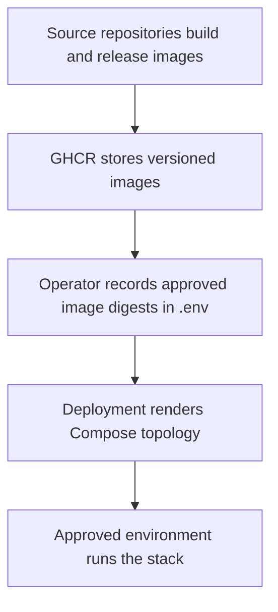

# Quick start

This repository assembles independently released GrooveMap service images. It
does not provide a source-development environment for those services.

## Prerequisites

- Git
- Docker Engine with Docker Compose v2
- python3 3.10 or newer (the distro's is enough; Debian 12 and Ubuntu 22.04 ship it)
- Optional: `just` for the recipe shortcuts; every operator recipe also works without `uv`, on
  the distro's python3. Maintainers can use [mise](https://mise.jdx.dev/) for the full toolchain
  (`just` and `uv`)
- enough memory and storage for the selected stack and imported datasets
- approved manifest digests for every required GrooveMap image

## The short way: `bash scripts/deploy.sh`

The [homelab guide](homelab.md) covers sizing, ports, reverse proxies, upgrades and known
limitations in full. This section is the short version.

On a Docker host you control, one command takes GrooveMap from nothing to fully
loaded, Discogs first and MusicBrainz after it:

```bash
git clone https://github.com/groovemap-music/deployment.git
cd deployment
bash scripts/deploy.sh
```

With `just` installed (`mise install`), `just deploy` runs the same script.

It checks the host, writes `.env` (`just env-init`) and `secrets/`
(`just secrets-bootstrap`), sizes Neo4j for the machine
([sizing](configuration.md#neo4j-sizing-written-by-just-deploy)), starts the
production stack without the `musicbrainz` profile, and waits for the Discogs
import (about two days on the reference hardware). When the import has
finished it sets `COMPOSE_PROFILES=musicbrainz` in `.env`, starts MusicBrainz,
prints the endpoints, and offers to create the first admin account.

Ctrl-C, a closed terminal or a reboot loses nothing: the import keeps running
in Docker, and re-running `bash scripts/deploy.sh` resumes the wait. Once MusicBrainz is
enabled, a run only brings the stack up to date. A deployment that already runs
MusicBrainz keeps it.

| Option | Effect |
| --- | --- |
| `--dev` | Use the base development stack instead of the production overlay |
| `--no-wait` | Start phase 1 and exit; re-run later to continue |
| `--no-admin` | Do not offer to create the first admin |
| `--admin-email EMAIL` | Create the first admin with this email (prompts for the password) |
| `-p`, `--project-name NAME` | Compose project name |
| `--interval SECONDS` | Seconds between import checks while waiting (default 300) |
| `-y`, `--yes` | Go ahead under amd64 emulation on an arm64 host without asking |
| `--force` | Go ahead below the memory and disk minimums |

Exit codes: `0` done (or phase 1 started with `--no-wait`), `1` a step failed,
`2` bad arguments, `3` stopped by the host checks before changing anything (or
by the override check before any container started), `130` interrupted while
waiting.

Host-specific settings go in an untracked `docker-compose.override.yml` next to
the tracked Compose files; see
[Docker Compose Override](configuration.md#4-docker-compose-override). When it
exists, deploy adds it last to every Compose call and to the import gate.

The host checks stop below these minimums unless you pass `--force`, and warn
below the recommended sizes. The disk check runs once the override is in place and follows
volumes relocated there; see [Hardware and sizing](homelab.md#hardware-and-sizing):

| Check | Minimum | Recommended | Source |
| --- | --- | --- | --- |
| Memory for Docker, production | 16 GB | 32 GB | Neo4j sizing above, plus PostgreSQL's 2 GB shared buffers and 6 GB cache in `docker-compose.prod.yml` |
| Memory for Docker, `--dev` | 8 GB | 16 GB | Neo4j's fixed 2 GiB heap and 1 GiB page cache in `docker-compose.yml` |
| Free disk, new install, on each disk that holds data volumes (summed shares) | 100 GB | 200 GB | Discogs is ~76 GB on disk plus its ~11.3 GB dump ([architecture](architecture.md), "Dataset Scale"); MusicBrainz is not measured yet, so the recommendation assumes it is as large |

On an existing deployment the disk check only warns below 20 GB free. Every
configured host port must be free (ports the stack already holds are fine), and
Docker Engine with Compose v2 must be working. GrooveMap's own images are built
for `linux/amd64` only; on an arm64 host they run under emulation, much more
slowly, and deploy asks before going ahead (Linux needs amd64 binfmt emulation
registered first).

`just deploy` starts containers, so `just check` and CI never run it. The steps
below are the manual path it automates.

## 1. Clone and validate

```bash
git clone https://github.com/groovemap-music/deployment.git
cd deployment
mise install
just setup
just check
```

The gate is credential-free and does not start containers. See the
[deployment validation guide](testing-guide.md) for its exact scope.

## 2. Configure immutable images

Create an untracked environment file:

```bash
cp .env.example .env
```

Replace every `REPLACE_WITH_64_HEX_CHARACTERS` placeholder with the manifest
digest of an approved source-repository release. The required form is:

```dotenv
DATABASE_SCHEMA_IMAGE=ghcr.io/groovemap-music/database-schema@sha256:<digest>
CATALOG_API_IMAGE=ghcr.io/groovemap-music/catalog-api@sha256:<digest>
```

Apply the same pattern to all remaining image variables. Tags alone and
`latest` are rejected. See [Container image standards](dockerfile-standards.md)
for the complete ownership map.

The reviewed release for each variable is recorded in `RELEASED_IMAGE_DIGESTS`
in `scripts/check-images.py`, with the release tag beside each digest. Once
`.env` promotes them, `just smoke-released` verifies it against that set before
it starts anything.

## 3. Review the rendered configuration

The base stack contains deliberate local-development credentials. Render and
review it before any start:

```bash
just config
```

For a production-shaped configuration, first generate untracked secret files:

```bash
just secrets-bootstrap
just config-prod
```

`just secrets-bootstrap` is idempotent, creates `secrets/` with restrictive
permissions, and never prints secret values. Supply any optional provider keys
before deploying. See [Configuration](configuration.md) and
[Docker security](docker-security.md).

## 4. Start only with operator approval

For a first start, use `just deploy` ([above](#the-short-way-bash-scriptsdeploysh)): it runs the
Discogs import to completion before it starts MusicBrainz, which a plain `up` would not. After
reviewing the exact image digests, configuration, backup state, and target environment, the
approved operator may run it. `just down` likewise changes the live environment and requires
approval.

`just smoke` starts the development stack and waits for service health, which is useful for
validating a change but not a way to install GrooveMap: it never runs the staged load or
enables MusicBrainz, and it is excluded from CI and `just check`. To bring an
already-loaded production stack up by hand, use the reviewed command for the target
environment (add `-f docker-compose.override.yml` last if you have one):

```bash
docker compose -f docker-compose.yml -f docker-compose.prod.yml up -d --wait
```

MusicBrainz starts with this command only when `COMPOSE_PROFILES=musicbrainz` is set in
`.env`; see [Upgrading an existing deployment](homelab.md#upgrading-an-existing-deployment).

## Service endpoints

The base configuration publishes these local endpoints:

| Component | Endpoint | Development credentials |
| --- | --- | --- |
| Operations console | <http://localhost:8003> | Application-specific |
| Catalog API | <http://localhost:8004> | Register through the API |
| Catalog API health | <http://localhost:8005/health> | None |
| Graph explorer | <http://localhost:8006> | None |
| Graph explorer health | <http://localhost:8007/health> | None |
| Neo4j Browser | <http://localhost:7474> | `neo4j` / `groovemap` |
| Neo4j Bolt | `localhost:7687` | `neo4j` / `groovemap` |
| PostgreSQL | `localhost:5433` | `groovemap` / `groovemap` |
| RabbitMQ management | <http://localhost:15672> | `groovemap` / `groovemap` |
| RabbitMQ AMQP | `localhost:5672` | `groovemap` / `groovemap` |
| RabbitMQ Prometheus metrics | <http://localhost:15692/metrics/detailed> | None; loopback only |
| Valkey | `localhost:6379` | No base-stack password |
| Grafana | <http://localhost:3000> | Anonymous Viewer access |
| VictoriaMetrics | <http://localhost:8428> | None; development only |
| VictoriaTraces | <http://localhost:10428> | None; development only |

These credentials are for local development only. The production overlay uses
file-backed secrets, disables anonymous Grafana access, and loopback-binds
Valkey and both unauthenticated Victoria backends.

Extractor, consumer, schema-initializer, analytics, exporter, and collector
ports are internal-only. Inspect their container health with
`docker compose ps`; do not assume an internal port is published on localhost.

## Observe the stack

Use Compose to inspect status and logs:

```bash
docker compose ps
docker compose logs --tail=100
docker compose logs --tail=100 api
```

Follow logs only when interactive streaming is appropriate:

```bash
docker compose logs --follow api
```

Operational detail lives in the [Monitoring](monitoring.md),
[Administration](admin-guide.md), and [Troubleshooting](troubleshooting.md)
guides. Service-level development instructions live in each source repository.

## Repository map



The deployment repository is intentionally unversioned. Each source
repository versions its own artifact; an environment is identified by the full
set of promoted image digests.
