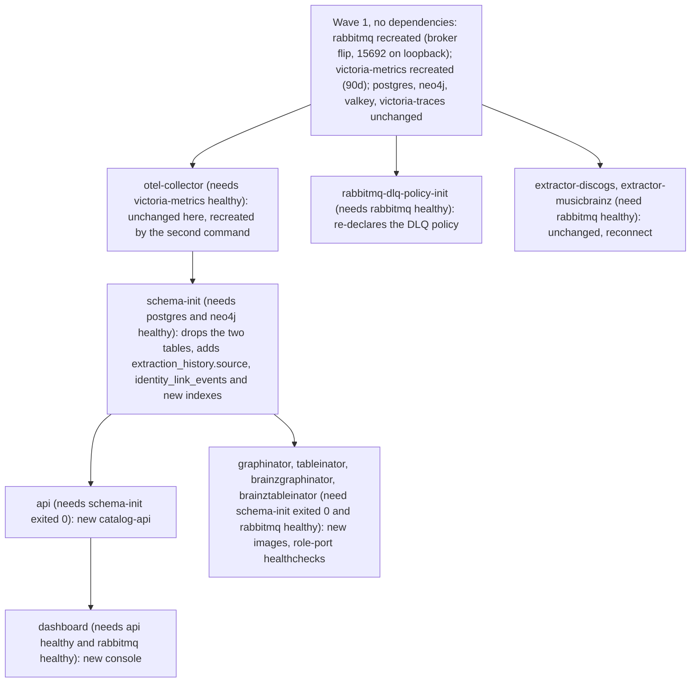

# Rollout: operations console redesign, broker-stats retirement, source-routed triggers, role-based health ports (October 2026)

This guide releases and deploys the work that landed across nine repositories on
2026-10-23 and 2026-10-24:

- the operations console rebuilt as one authenticated shell
  ([ADR 0018](https://github.com/groovemap-music/design/blob/main/docs/adr/0018-operations-console-single-shell.md)),
  with history read from VictoriaMetrics, an attention bar, an event feed, deep links, run
  progress and a topology drill-down;
- RabbitMQ queue statistics read from `rabbitmq_prometheus` instead of the management plugin's
  metrics collector, which is switched off
  ([ADR 0017](https://github.com/groovemap-music/design/blob/main/docs/adr/0017-broker-metrics-from-rabbitmq-prometheus.md));
- the PostgreSQL metrics-history collector, its two routes and its two tables retired;
- extraction triggers that name their source and reach that source's extractor;
- role-based health ports for the four consumers (graph enrichers on `8001`, SQL loaders on
  `8002`), and consumers that exit with status 1 when their startup gives up;
- a hardened console: the admin session is an HttpOnly cookie that is Secure by default (the
  production console must be reached over HTTPS), credentialed CORS is gone, and
  `catalog-api` purges dead-letter queues over AMQP, so it no longer needs the RabbitMQ
  management API.

It is written for an operator or agent with no other context. Work through it from top to
bottom. Every step names a command, the result to expect, and what to do when the result
differs. Every constraint states its reason.

## Conventions

- `WORKSPACE` is the directory that holds the sibling clones (`$WORKSPACE/catalog-api`,
  `$WORKSPACE/deployment`, and so on). `LIVE` is the `deployment` checkout the target
  environment's stack runs from: it holds that environment's untracked `.env` and `secrets/`.
  `PRIVATE` is a directory outside every repository, created with `mkdir -m 700`, for renders,
  backups and dumps. Files in `PRIVATE` contain secrets; delete them when the rollout is closed.
- Shell variables do not survive between separate command invocations. Every block below sets
  what it needs; substitute the real paths for `WORKSPACE=...`, `LIVE=...` and `PRIVATE=...`.
- Compose commands are written for production, with both files:
  `docker compose -f docker-compose.yml -f docker-compose.prod.yml`. For a non-production
  environment, drop `-f docker-compose.prod.yml`.
- Every `docker compose` command parses the whole Compose file, including the `embeddings` job
  (profile `jobs`, never started here), whose `SOURCE_DUMP_ID` and `SOURCE_DUMP_DATE` have no
  default. When Compose answers `required variable SOURCE_DUMP_ID is missing a value` (observed
  with Compose 5.6.1), put placeholders in the shell before the first command:
  `export SOURCE_DUMP_ID=rollout SOURCE_DUMP_DATE=2000-01-01`. Nothing reads them in this
  rollout. Do not put them in `.env`: [`.env.example`](../.env.example) keeps them out on purpose,
  so that a real embedding run cannot reuse a stale dump id.
- **[approval]** marks a step that pushes, tags, publishes, or changes a running environment.
  Ask the human for explicit approval of that exact action and target before running it.
  Approval of one step does not cover another. The approval list in
  [Environment changes](maintenance.md#environment-changes) still applies.
- "Stop" means: do not continue to the next step; report what you saw to the human.

## 1. Scope and preconditions

### 1.1 Repositories and the minimum commit each release must contain

| Repository | Image variable | Minimum commit | Why that commit | `main` when this guide was written |
| --- | --- | --- | --- | --- |
| `database-schema` | `DATABASE_SCHEMA_IMAGE` | `d0c8c90` and `825bd5c` | `d0c8c90` adds the `extraction_history.source` column and contains the table drop (`94860d5`); `825bd5c` adds `public.identity_link_events`, which the `musicbrainz-sql-loader` release needs | `ddcb54a` |
| `catalog-api` | `CATALOG_API_IMAGE` | `b9154f4` | contains the session route (`596a853`), the retired collector (`b8f5adb`), source routing (`9066cb7`), the source-aware tracker (`af4f363`), the AMQP dead-letter purge (`683b21b`) and per-source `record_counts` (`1846ce0`) | `b9154f4` |
| `operations-console` | `OPERATIONS_CONSOLE_IMAGE` | `061775d` | contains every console change, ending with the HttpOnly session cookie (molecule `3vi9`, `357e73a`), server-side queue events (`zkk3`) and per-run e2e ports (`zz2c`), merged as `udba`; the role-based health ports (`e51b7fa`) are below it | `061775d` |
| `musicbrainz-graph-enricher` | `MUSICBRAINZ_GRAPH_ENRICHER_IMAGE` | `de11b1a` | health on `8001` (`e1ad948`), empty `HEALTH_PORT` rejected (`5d8dfa9`), exit 1 (`de11b1a`) | `09d40bb` |
| `musicbrainz-sql-loader` | `MUSICBRAINZ_SQL_LOADER_IMAGE` | `9353776` | health on `8002` (`30de8e0`), exit 1 (`9353776`) | `384e202` |
| `discogs-graph-enricher` | `DISCOGS_GRAPH_ENRICHER_IMAGE` | `4d70985` | `HEALTH_PORT` override (`204bc85`), exit 1 (`4d70985`) | `361116d` |
| `discogs-sql-loader` | `DISCOGS_SQL_LOADER_IMAGE` | `6b8fa03` | `HEALTH_PORT` override (`5faa9b5`), exit 1 (`6b8fa03`) | `1b320dc` |
| `operations-toolkit` | none: operators run it from a checkout | `89a9d12` | queue CLIs read `/metrics/detailed` | `49e0935` |
| `deployment` | none: unversioned, applied from `main` | `98605ab` | contains all eight deployment commits below; `98605ab` is the last (`SESSION_COOKIE_SECURE` for development, reset in production) | `ee607d9` |

Unchanged by this rollout: `discogs-ingestion`, `musicbrainz-ingestion`, `graph-explorer` and
`analytics-engine`. (`graph-explorer` `main` has since moved to Node 26.12.1, `ce62a4a`; nothing
here needs it, so it ships whenever the human chooses.) Leave `DISCOGS_INGESTION_IMAGE`, `MUSICBRAINZ_INGESTION_IMAGE`,
`GRAPH_EXPLORER_IMAGE` and `ANALYTICS_ENGINE_IMAGE` as they are. Both extractors' released
images already serve `POST /trigger` and the `/health` fields the new tracker reads. `design`
holds ADRs 0017 and 0018 and deploys nothing.

### 1.2 This program's commits

- `deployment`: `ad98eb5` publish `rabbitmq_prometheus` `15692` on `127.0.0.1`; `5cbb2ce`
  VictoriaMetrics `-retentionPeriod=90d`; `10d307c` `-rabbitmq_management_agent
  disable_metrics_collector true` replaces `-rabbitmq_management disable_management_stats
  false`, and the console's `RABBITMQ_HOST`/`RABBITMQ_USERNAME`/`RABBITMQ_PASSWORD` (and its
  `rabbitmq_*` secrets in production) are removed; `5f0b4b1` the `rabbitmq-detailed` scrape job;
  `57787bf` the console's `VICTORIA_METRICS_URL`, `GRAFANA_URL`, `TRACES_URL`,
  `GRAFANA_TOKEN_FILE` and the `grafana_viewer_token` secret; `0327f97`
  `GRAFANA_API_URL=http://grafana:3000`; `b47655d` `brainzgraphinator` and
  `brainztableinator` healthchecks on `8001` and `8002`; `98605ab` `SESSION_COOKIE_SECURE=false`
  on the base file's `dashboard` and `SESSION_COOKIE_SECURE: !reset null` in the production overlay.
- `operations-console`, molecules `xcg` (live queue metrics from `/metrics/detailed`, no
  AMQP), `t34` (authenticated shell, Overview matrix, VictoriaMetrics history, attention bar,
  event feed, deep links, run progress, topology drill-down), `wcew` (both trigger paths send
  `source`; catalog-api contract promoted to `9066cb7`), `azaz` (`GRAFANA_API_URL`), `q91q`
  (health for every long-running service), `k5lm` (role-based health URLs), `3vi9` (HttpOnly
  session cookie, same-origin checks, CORS off by default), `zkk3` (queue events computed on the
  server), `zz2c` (per-run e2e ports), merged together as `udba`.
- `catalog-api`, molecules `nfk4` (`GET /api/admin/auth/session`), `w8uc` (collector moved to
  `/metrics/detailed`), `gz4r` (collector and history routes retired), `intt` (trigger routed by
  `source`, `source` persisted), `dl86` (tracker requires `source`), `p6wx` (dead-letter purge over
  AMQP, per-source `record_counts`).
- `database-schema`, molecules `739r` (drop `queue_metrics` and `service_health_metrics`) and
  `3poz` (nullable `extraction_history.source` with a CHECK and an index).
- `operations-toolkit`, molecule `539` (`check-queues`, `monitor-queues`, `system-monitor` read
  `/metrics/detailed`).
- `discogs-graph-enricher` `hm2` and `0n1`, `discogs-sql-loader` `2kq` and `5zm`,
  `musicbrainz-graph-enricher` `0ij`, `c8x` and `6wa`, `musicbrainz-sql-loader` `bw1` and `50w`.

### 1.3 Other sessions' work ships too

A release tags `main`, so it carries every commit since the previous tag, not only this
program's. All of the following ship in the same releases. This guide verified the
compatibility of this program's changes only; the human must confirm that the rest may ship
(step P9).

| Repository | Other work since the last tag (molecule ids, newest first) |
| --- | --- |
| `database-schema` (since `v0.4.1`) | `igu0` publication hygiene; `09mv` `public.identity_link_events`; `8gsl` filelock cooldown removed; `8kc2`, `ixhu`, `kazl`, `b0mk` Strata insights tables and a `musicbrainz.releases (release_group_mbid)` index; `jmd9`, `yn5v`, `uxd1` dependency security; `x45l`, `f4k9`, `afan` MusicBrainz schema research; `hqjp`, `2xe0` compact similar-artist lists; `5wsk` SQL/PGQ removal; `jb9b` tested runtime revision; `ug3v` per-track credit graph relations; `19g5` artist kNN through the embedding refresh; `7e690d3` and Dependabot updates |
| `catalog-api` (since `v0.5.0`) | `j0sd` publication hygiene; `s74h` filelock cooldown removed; `n8vb`, `31ag`, `m4mn`, `r8c7`, `l1x9`, `3s01`, `bcre` Strata routes; `9xas`, `p04r`, `dqah` dependency security; `7hu4` keep a recorded `date_added`; `2zsq` similar artists from precomputed lists (behind a switch); `gtcr`, `qk92`, `foix` Valkey hardening; Dependabot updates; `za77` and `cn2v` (Identity Ledger backfill and read-only admin routes). `v0.5.0` itself was never published (see [Known issues](#7-known-issues-that-are-not-blockers)), so its content (the Valkey client migration among it) also reaches production for the first time |
| `operations-console` (since `v0.1.1`) | `ux1n` publication hygiene; `ipcv`, `mb0p`, `7kua` and the Degrees brand promotion (`85845d4`); `5cq` filelock cooldown removed; `nd3` Node.js toolchain security bump; and the 36 merges that were already on `origin/main` before this program's, among them `gvm` (OpenTelemetry metrics export; its `7fd8e30` removed the Prometheus `/metrics` endpoint), `wmi` (tracing), `4ww` (Redis payload fallback removed) and `0nc` (Valkey relabel) |
| `musicbrainz-sql-loader` (since `v0.4.0`) | `44v` publication hygiene; `nxc` Strata M6 Discogs-link changes recorded at load (needs `database-schema` `825bd5c`); `1sb`, `kdl`, `ou7`, `uy2` dependency work; Dependabot updates |
| `musicbrainz-graph-enricher` (since `v0.3.1`) | `mvg` publication hygiene; `nhz`, `8ix`, `uwc`, `d7f` dependency work; `569` tag-mapping spike documentation; Dependabot updates |
| `discogs-graph-enricher` (since `v0.3.0`) | `j8x` publication hygiene; `80g` stop projecting the Discogs `0` master sentinel as a Master; `t1h` consumer-cancel hang fix; `zxw` bounded log files; dependency work; Dependabot updates |
| `discogs-sql-loader` (since `v0.3.0`) | `3as` publication hygiene; `dsu` PGQ-only code removed; `2eg`, `b2a`, `pas`, `vkb` catalog graph relations; `2up`, `vd0` derived refresh moved to a scheduled worker; `q7q` consumer-cancel hang fix; dependency work; Dependabot updates |
| `operations-toolkit` (never tagged) | `7ch` publication hygiene; `p1z` filelock cooldown removed |
| `deployment` | `4q21` publication hygiene; `701a` filelock cooldown removed; earlier CI and lockfile merges. None changes a Compose file, `config/` or `scripts/` |

The production environment may run releases older than the last tag (the reviewed set in
`scripts/check-images.py` records `database-schema` `v0.5.0`, `catalog-api` `v0.4.0` and the
MusicBrainz consumers `v0.2.0`). Everything between what runs and the new release reaches
production. `database-schema` `v0.5.0` (tagged 2026-10-27, with the table drop and the new
columns, indexes and tables listed above) is already published and pinned there, so its release
steps below are done; confirm that before cutting it again.

### 1.4 Telling the sessions' work apart

For each repository, from `$WORKSPACE/<repository>`:

```bash
git fetch origin --tags
git log --oneline origin/main..main                                   # local, unpushed commits
git log --first-parent --format='%h %s' "$(git describe --tags --abbrev=0 origin/main)"..origin/main
```

The second command lists what the next release will contain. Each `chore(merge): molecule <id>`
line is one molecule; `bh work issue <id>`, run inside that repository, prints its title. A
molecule not named in [1.2](#12-this-programs-commits) is another session's work. For
`operations-toolkit` and `deployment`, which have no tags, compare against the revision the
operators or the live checkout currently run instead of a tag.

### 1.5 Preconditions

**P1. Confirm the approval model.** Tell the human which steps carry **[approval]**: every
`git push`, every tag, every rerun of a release workflow, the backup dump, every Compose
`pull`/`up`/`stop`, and any extraction trigger. Expected: the human acknowledges. If the human
wants to approve the whole rollout at once, record that statement and its scope.

**P2. Check the tools.**

```bash
gh auth status && docker buildx version && docker compose version --short && just --version && uv --version && python3 --version
```

Expected: `gh` is logged in to an account that can push to `groovemap-music`, and every command
prints a version. Docker Compose must be **2.24.0 or later** (the version that introduced the
`!reset` and `!override` YAML tags; checked here with 5.6.1 only): the production overlay
resets `SESSION_COOKIE_SECURE` with `!reset null`, and the smoke overlays
(`docker-compose.erasure-smoke.yml`, `docker-compose.media-smoke.yml`) already use `!reset`. An
older Compose rejects the tag or ignores it, and the dev opt-out would then reach production.
If not: stop.

**P3. Check every clone is clean, on `main`, and pushed.**

```bash
WORKSPACE=...   # the directory holding the clones
for r in database-schema catalog-api operations-console musicbrainz-graph-enricher \
         musicbrainz-sql-loader discogs-graph-enricher discogs-sql-loader operations-toolkit deployment; do
  git -C "$WORKSPACE/$r" fetch --quiet origin --tags
  printf '%-28s branch=%s dirty=%s unpushed=%s behind=%s head=%s\n' "$r" \
    "$(git -C "$WORKSPACE/$r" branch --show-current)" \
    "$(git -C "$WORKSPACE/$r" status --porcelain | wc -l | tr -d ' ')" \
    "$(git -C "$WORKSPACE/$r" rev-list --count origin/main..main)" \
    "$(git -C "$WORKSPACE/$r" rev-list --count main..origin/main)" \
    "$(git -C "$WORKSPACE/$r" rev-parse --short origin/main)"
done
```

Expected: every line shows `branch=main dirty=0 unpushed=0`. When this guide was written every
`main` had been pushed. If `unpushed` is not 0: list those commits with `git log --oneline
origin/main..main`, identify them with [1.4](#14-telling-the-sessions-work-apart), and ask the
human whether to push them **[approval]** (`git -C "$WORKSPACE/<r>" push origin main`). If
`behind` is not 0, run `git -C "$WORKSPACE/<r>" pull --ff-only`. If `dirty` is not 0, stop:
someone has uncommitted work in that clone.

**P4. Compare each `head` with the table in [1.1](#11-repositories-and-the-minimum-commit-each-release-must-contain).**
Expected: equal. If a head moved, list the new commits (`git log --first-parent --oneline
<head in the table>..origin/main`) and show them to the human; they ship too.

**P5. Confirm each minimum commit is on `origin/main`.**

```bash
WORKSPACE=...
while read -r r c; do
  git -C "$WORKSPACE/$r" merge-base --is-ancestor "$c" origin/main && echo "ok   $r $c" || echo "MISSING $r $c"
done <<'EOF'
database-schema d0c8c90
database-schema 825bd5c
catalog-api b9154f4
operations-console 061775d
musicbrainz-graph-enricher de11b1a
musicbrainz-sql-loader 9353776
discogs-graph-enricher 4d70985
discogs-sql-loader 6b8fa03
operations-toolkit 89a9d12
deployment 98605ab
EOF
```

Expected: ten `ok` lines. If any line says `MISSING`: stop.

**P6. Confirm hosted CI is green on each head.**

```bash
WORKSPACE=...
for r in database-schema catalog-api operations-console musicbrainz-graph-enricher \
         musicbrainz-sql-loader discogs-graph-enricher discogs-sql-loader operations-toolkit deployment; do
  printf '%-28s ' "$r"
  gh run list --repo "groovemap-music/$r" --workflow ci.yml --commit "$(git -C "$WORKSPACE/$r" rev-parse origin/main)" \
    --json status,conclusion --jq '.[0] | "\(.status) \(.conclusion)"'
done
```

Expected: `completed success` on every line. If `in_progress`: wait and re-run. If `failure`:
stop; a release built from a red `main` is not reviewable.

**P7. Confirm the target host's architecture.** On the host that runs the stack:
`docker info --format '{{.Architecture}}'`. Expected: `x86_64`. The release workflows publish
`linux/amd64` images only; on an `aarch64` host `pull` ends with `no matching manifest for
linux/arm64/v8`. If not: stop.

**P8. Confirm a PostgreSQL backup.** Ask the human for the timestamp of the most recent
PostgreSQL backup and its last restore drill (see
[Backups and restore drills](maintenance.md#backups-and-restore-drills)). Expected: a backup
taken today. If not: stop. The `database-schema` release drops two tables and adds columns,
indexes and tables; a backup is the only full recovery path.

**P9. Get the human's confirmation of the other sessions' work.** Show the human
[1.3](#13-other-sessions-work-ships-too) plus anything P4 found. Expected: an explicit "ship it".
If the human wants to hold some of it back: stop; holding back merged work needs a revert or a
release branch in that repository, which this guide does not cover.

**P10. Decide the `database-schema` version.** `just bump-preview` in `database-schema`
computes `1.0.0`: `f462dd9` is marked breaking (`feat(postgres)!`) and the Commitizen
configuration does not set `major_version_zero`. Ask the human: `1.0.0` (the default), or
`0.5.0` (bump with `--increment MINOR`, see [3.1](#31-database-schema)). The consumers pin
`database-schema` by git revision, so either choice is safe for them.

**P11. Find out how the production console is reached, and stop if it is plain HTTP.** The
console's session cookie is Secure by default, and the production overlay does not opt out.
Ask the human: what URL do operators open for the console, and what terminates TLS in front of
port `8003`? Expected: an `https://` URL served by a TLS endpoint that meets
[the requirements](configuration.md#console-session-cookie-and-https) (passes `Cookie` and
`Set-Cookie` unchanged; passes `X-GrooveMap-Console`, `Sec-Fetch-Site`, `Origin` and
`Authorization`; keeps the browser's `Host`; serves the console at the root of its own host
name; forwards `/ws` with `Upgrade`; does not log `/ws` query strings, `Cookie` or
`Set-Cookie`). **If operators reach the console over plain `http://<host>:8003`, stop and tell
the human.** After the rollout, sign-in over plain HTTP fails without any error message: the
browser drops the Secure cookie and the page returns to the login form. Observed: Chromium and
Firefox still sign in on `http://localhost`, which they treat as a secure context, but Safari
(WebKit) on `http://localhost`, and every browser on a non-localhost host name, stay on the login
form. Do not work around it with `SESSION_COOKIE_SECURE=false` in production; an HTTPS endpoint
in front of the console is the fix, and it is the human's decision to provide one first.

## 2. Hard constraints

Each constraint below is what makes the order in sections 3 and 4 necessary. The single
Compose apply in [4.10](#410-apply-approval) satisfies all of them; the staged alternative in
[4.12](#412-staged-alternative) satisfies them with a verification gate between stages.

### What must ship together

| # | Ship together | Reason |
| --- | --- | --- |
| T1 | The `musicbrainz-graph-enricher` and `musicbrainz-sql-loader` releases, `deployment` `b47655d`, and `operations-console` `e51b7fa` | The released images (up to `v0.3.1` and `v0.4.0`) serve `/health` on `8011` and `8010`. `b47655d` probes `8001` and `8002`, and the console polls `8001` and `8002`. Any mix marks both containers unhealthy and shows them down in the console, even though they consume normally. |
| T2 | The broker flip (`deployment` `10d307c`) with the console (`061775d`), `catalog-api` (`b9154f4`) and the toolkit (`89a9d12`) | With `disable_metrics_collector true`, the management API's `GET /api/queues` omits `messages`, `messages_ready`, `messages_unacknowledged`, `consumers` and `message_stats` (checked against the pinned `rabbitmq:4-management` image, RabbitMQ 4.3.6). Console `v0.1.1` and the toolkit before `765b115` read those fields and report 0 for every queue, and the `catalog-api` collector up to `v0.5.0` records 0. Console `v0.1.1` also opens an AMQP connection with the `RABBITMQ_*` credentials that `10d307c` removes from its service. |
| T3 | `operations-console` (`4de8342` or later) with `catalog-api` (`9066cb7` or later) | `catalog-api` from `9066cb7` answers 422 to a trigger without a `source`; console `v0.1.1`'s Discogs button posts no body, so it fails. The reverse is worse: `catalog-api` up to `v0.5.0` ignores the body and always posts `{"force_reprocess": true}` to the Discogs extractor, so a MusicBrainz button press, from either console, starts a full Discogs reprocess. Never press a trigger button while the running `catalog-api` predates `9066cb7`. |
| T4 | The console image (`061775d`) with `deployment` `98605ab` and an HTTPS endpoint in front of the production console | The new console's cookie is Secure and the setting must ship in the same change as the image: the production overlay must reset the base file's `SESSION_COOKIE_SECURE=false`, and the operators must reach the console over HTTPS (P11). Without that, every operator is stuck on the login form. |

### What must come first

| # | First | Then | Reason |
| --- | --- | --- | --- |
| F1 | `catalog-api` `596a853` (`GET /api/admin/auth/session`) | console `933e5fd` (the authenticated shell) | The console gates every data route and the WebSocket on that route. A `404` from an older `catalog-api` is "unavailable" to the console, which then answers 503 to everything and signs nobody in. Compose starts `dashboard` only after `api` is healthy. |
| F2 | `database-schema` `d0c8c90` applied by `schema-init` | `catalog-api` `3e92a90` serving | The new `catalog-api` inserts and selects `extraction_history.source`. Compose starts `api` only after `schema-init` exits 0 (`service_completed_successfully`). |
| F3 | `catalog-api` without the collector (`b8f5adb`) | `database-schema` `94860d5` (the drop) | `f462dd9`'s commit message: do not apply before that `catalog-api` is deployed. The old collector writes both tables every 300 seconds and its history routes read them. See the note below. |
| F4 | `database-schema` `825bd5c` applied | `musicbrainz-sql-loader` release starting | The release (through `26f2fca`, another session's) records Discogs-link changes in `public.identity_link_events`. Compose starts `brainztableinator` only after `schema-init` exits 0. |
| F5 | `deployment` `5f0b4b1` (`rabbitmq-detailed` scrape) and `5cbb2ce` (90-day retention) | Relying on the console's history tabs | The console's publish and ack rate history queries `rabbitmq_detailed_queue_exchange_messages_published_total` and `rabbitmq_detailed_queue_messages_acked_total`, which only exist once that job scrapes. ADR 0018 requires `-retentionPeriod` of at least 90 days before the tabs read VictoriaMetrics; at 15 days the 30d and 90d ranges are silently truncated. Rate history begins when the scrape starts. |
| F6 | `operations-toolkit` `89a9d12` in every operator checkout | The broker flip | The older toolkit reads the management API and shows zeros after the flip. The new toolkit reads `http://localhost:15692`, which only `ad98eb5` publishes, so it works only once the apply has run. Update the checkouts just before the apply and verify after. |
| F7 | Readers moved (console, `catalog-api`, toolkit) | The broker flip (ADR 0017: "`deployment` flips the broker last") | Flipping first leaves unmigrated readers on empty management stats. In the single apply, Compose recreates `rabbitmq` in its first wave because it has no dependencies, so the flip lands seconds before the new readers start; during those seconds the old console and `catalog-api` show zeros. That is accepted here. The staged alternative follows the ADR literally. |

Note on F3 and F2 together: one `database-schema` image carries both the column the new
`catalog-api` needs and the drop the old one must not see, so some overlap is unavoidable. In
the single apply, `schema-init` runs while the old `api` is still serving, because Compose
recreates `api` only after `schema-init` exits 0. In that window the old collector's writes fail
and `v0.4.0` and `v0.5.0` catch the error and log `❌ Error persisting metrics`; their history
routes fail. Nothing crashes, and the window ends when `api` is recreated. The staged
alternative can stop `api` first instead, at the cost of an API outage for the whole
`schema-init` run.

### Operating constraints

| # | Constraint | Reason |
| --- | --- | --- |
| O1 | No extraction runs during the apply | The apply recreates `rabbitmq`, which drops every AMQP connection; a running extraction's publishing is interrupted mid-file. |
| O2 | Run Compose from `LIVE`, under the stack's existing project name | The Compose files declare no `name:`, so the project name is the checkout directory's base name, and `container_name` is fixed to `groovemap-*`. From another directory Compose would create a second project with empty volumes and collide on container names. |
| O3 | Recreate `otel-collector` explicitly with `--force-recreate` | `config/otel-collector.yaml` is a bind-mounted file. Compose does not see file content, so `up -d` leaves the collector running with the old scrape list; and `git` replaces the file with a new inode, which a plain `restart` may not pick up. |
| O4 | Do not deploy `catalog-api` `v0.5.0` | Its tag exists but no image was published (release run 37364646187 failed: no hosted runner acquired the job). |
| O5 | The Discogs consumer releases are not coupled to anything above | Their health ports do not change (`8001` and `8002` already). They may ship in the same window or later. |
| O6 | A trigger is a full reprocess | Both the old and new `catalog-api` post `{"force_reprocess": true}` to the extractor, and a Discogs run must finish, consumers drained, before a MusicBrainz one starts ([Post-import identity maintenance](maintenance.md#post-import-identity-maintenance)). Verification in section 5 therefore proves the trigger contract without starting a run; starting one is a separate **[approval]**. |

## 3. Release steps per repository

No image reaches an environment until section 4, so the order of the releases below does not
affect production. The order follows the runtime dependencies so that a failed release stops the
rollout before anything that depends on it is tagged.

### 3.0 The release procedure (used by every repository)

Each repository releases the same way: `just bump` updates the version files and `CHANGELOG.md`
only; you commit that as `bump: version <old> → <new>`, push it, wait for hosted CI, then push an
annotated `v<new>` tag. The tag starts `.github/workflows/release.yml`, which runs the
repository's checks and publishes `ghcr.io/groovemap-music/<repository>:v<new>`. There is no
GitHub release object; the release notes are the `CHANGELOG.md` entry and the tag message.
Run every command from `$WORKSPACE/<repository>`.

1. Update and check the clone: `git switch main && git pull --ff-only && git status --porcelain`.
   Expected: no output from `git status`. If not: stop.
2. Confirm the minimum commit: `git merge-base --is-ancestor <minimum> HEAD && echo ok`.
   Expected: `ok`. If not: stop.
3. Run the gate: `just setup && just check`. Expected: exit 0. If not: stop and report the
   failing recipe.
4. Preview: `just bump-preview`. Expected: lines `bump: version <old> → <new>` and
   `tag to create: v<new>`, with `<new>` as listed for the repository below. If `<new>` differs,
   stop and ask.
5. Bump: `just bump` (for `database-schema` with `0.5.0` chosen in P10, run
   `uv run cz bump --version-files-only --changelog --yes --check-consistency --increment MINOR`
   instead). Expected: `git status --short` shows `CHANGELOG.md`, `pyproject.toml`, `uv.lock`
   and the package's version file modified (the console also `package.json` and
   `package-lock.json`), nothing else.
6. Add the release notes: open `CHANGELOG.md`, and directly under the new `## v<new> (<date>)`
   heading add a `### BREAKING CHANGE` section with the bullets listed for the repository below
   (skip this when the repository lists none). Commitizen does not write this section: no commit
   carries a `BREAKING CHANGE:` footer, and only `database-schema`'s drop is marked `!` (which
   Commitizen lists under `Feat` only).
7. Re-run `just check`. Expected: exit 0 (it includes the version-consistency check).
8. Commit: `git add -A && git commit -m "bump: version <old> → <new>"`. Expected:
   `git show --stat HEAD` lists only the files from step 5.
9. **[approval]** Push: `git push origin main`. Expected: the push is accepted. If it is
   rejected because `origin/main` moved: do not force. Stop and ask; the bump has to be redone on
   the new `main`.
10. Wait for CI on the bump commit:
    `gh run list --workflow ci.yml --commit "$(git rev-parse HEAD)" --json databaseId,status,conclusion`,
    then `gh run watch <databaseId> --exit-status`. Expected: exit 0. If not: stop.
11. Tag: `git tag -a v<new> -m "v<new>" -m "<the BREAKING CHANGE bullets, or 'No breaking changes.'>"`.
    Expected: `git cat-file -p v<new>` shows `type commit` and `object` equal to
    `git rev-parse HEAD`.
12. **[approval]** Push the tag: `git push origin v<new>`.
13. Watch the release:
    `gh run list --workflow release.yml --branch v<new> --limit 1 --json databaseId,status,conclusion`,
    then `gh run watch <databaseId> --exit-status`. Expected: exit 0. If it failed with "The job
    was not acquired by Runner", ask for **[approval]** to rerun it (`gh run rerun <databaseId>`).
    For any other failure, stop. Never delete or move a pushed tag.
14. Confirm the tag contains the minimum commit:
    `git merge-base --is-ancestor <minimum> v<new> && echo contains`. Expected: `contains`.
15. Resolve the digest:

    ```bash
    docker buildx imagetools inspect ghcr.io/groovemap-music/<repository>:v<new> --format '{{ .Manifest.Digest }}'
    docker buildx imagetools inspect ghcr.io/groovemap-music/<repository>:v<new> | grep 'Platform:'
    ```

    Expected: `sha256:` followed by 64 hex characters, and a `Platform:    linux/amd64` line
    (the other `unknown/unknown` entry is the attestation). If `not found`: the release did not
    publish; go back to step 13. Append `<VARIABLE> <repository> v<new> sha256:<digest>` to
    `$PRIVATE/digests.txt`.

### 3.1 `database-schema`

Minimum `d0c8c90` and `825bd5c`; next version `1.0.0`, or `0.5.0` if chosen in P10.
**Done:** `0.5.0` was chosen and published as `v0.5.0` on 2026-10-27, and its digest is pinned
in `scripts/check-images.py`, so only the verification in step 15 remains. Its
procedure lives in `README.md` ("Versioning and release safety"); the repository has no
`docs/release-compliance.md`. Breaking changes for the notes (the drop is marked `!`, but the
generated entry lists it only under `Feat`):

- `queue_metrics` and `service_health_metrics` are dropped with `DROP TABLE IF EXISTS` on every
  `schema-init` run; their rows are not migrated. Deploy only with a `catalog-api` release that
  contains `b8f5adb` (the collector and the history routes removed), that is the release from
  3.2.
- `extraction_history` gains a nullable `source VARCHAR(20)` with
  `CHECK (source IN ('discogs', 'musicbrainz'))` and the index
  `idx_extraction_history_source_created_at`.

### 3.2 `catalog-api`

Minimum `b9154f4`; next version `0.6.0`. Breaking changes, none marked in the commits:

- `a9bda68` `refactor(admin)`: `GET /api/admin/queues/history`, `GET /api/admin/health/history`,
  the background metrics collector and the `METRICS_COLLECTION_INTERVAL` and
  `METRICS_RETENTION_DAYS` variables are removed. Queue and service-health history lives in
  VictoriaMetrics (ADR 0018).
- `cdf808d` `fix(admin)`: `POST /api/admin/extractions/trigger` requires a JSON body
  `{"source": "discogs" | "musicbrainz"}` and answers 422 without it. It calls that source's
  extractor (`EXTRACTOR_DISCOGS_HOST`/`EXTRACTOR_DISCOGS_HEALTH_PORT`, default
  `extractor-discogs:8000`; `EXTRACTOR_MUSICBRAINZ_HOST`/`EXTRACTOR_MUSICBRAINZ_HEALTH_PORT`,
  default `extractor-musicbrainz:8000`). `EXTRACTOR_HOST` and `EXTRACTOR_HEALTH_PORT` remain a
  Discogs-only fallback for one release. The response and the extraction list carry `source`.
- `3e92a90`: needs `database-schema` `d0c8c90` or later applied; it writes
  `extraction_history.source`.
- `683b21b` `feat(admin)`: dead-letter queues are purged over AMQP instead of the RabbitMQ
  management API, so `catalog-api` no longer needs the management API or its port. Nothing in
  the deployment changes for it; the management plugin stays enabled for the operators' own use.
- `1846ce0` `fix(admin)`: a run's `record_counts` carry only the entity types of that run's
  source, so a MusicBrainz run records `release_groups` and no longer a meaningless `masters: 0`.
- This is the first published image after `v0.4.0`: `v0.5.0` was tagged but never published.

### 3.3 `musicbrainz-graph-enricher`

Minimum `de11b1a`; next version `0.4.0`. Breaking changes, none marked:

- `7cb0eab` `feat(health)`: `/health` moves from `8011` to `8001`; `HEALTH_PORT` overrides it
  and a set-but-empty value is rejected (`8b056db`). Anything that probes `8011` must move.
- `946b29d` `fix(cli)`: the process exits with status 1 when startup gives up (it exited 0), so
  the base Compose file's `restart: on-failure` now restarts it.

### 3.4 `musicbrainz-sql-loader`

Minimum `9353776`; next version `0.5.0`. Breaking changes, none marked:

- `d94747d` `feat(health)`: `/health` moves from `8010` to `8002`, with a `HEALTH_PORT`
  override.
- `5cb6998` `fix(runtime)`: exit status 1 when startup gives up.
- Needs `database-schema` `825bd5c` or later applied (`public.identity_link_events`).

### 3.5 `discogs-graph-enricher`

Minimum `4d70985`; next version `0.4.0`. No breaking change: the health port stays `8001` and
gains a `HEALTH_PORT` override. Behaviour change for the notes: `7831046` exits with status 1
when startup gives up.

### 3.6 `discogs-sql-loader`

Minimum `6b8fa03`; next version `0.4.0`. No breaking change: the health port stays `8002` and
gains a `HEALTH_PORT` override. Behaviour change for the notes: `e6d77ad` exits with status 1
when startup gives up.

### 3.7 `operations-console`

Minimum `061775d`; next version `0.2.0`. Breaking changes, none marked:

- `933e5fd` `feat(console)`: one authenticated shell at `/`. `/api/metrics`, `/api/services`,
  `/api/queues`, `/api/queue-prefixes`, `/api/topology`, `/api/databases`, `/api/history/*`,
  `/api/progress/*`, `/api/alerts`, `/api/links`, `/admin/api/*` (except login and logout) and
  the `/ws` WebSocket require an admin session; `/ws` needs a ticket from `POST /api/ws-ticket`;
  `/admin` redirects to `/`. The monitoring view is no longer public. Requires `catalog-api`
  with `GET /api/admin/auth/session` (`596a853`). `cedfd34` also turns off `/docs` and
  `/openapi.json`.
- `f2ddc86` and `3f22873`: live queue metrics come from `RABBITMQ_PROMETHEUS_URL`
  (`/metrics/detailed`); `RABBITMQ_HOST`, `RABBITMQ_USERNAME`, `RABBITMQ_PASSWORD`,
  `RABBITMQ_MANAGEMENT_HOST`, `RABBITMQ_MANAGEMENT_PORT` and the AMQP connection are no longer
  used.
- `9f29dae` and `74a6905`: history is read from `VICTORIA_METRICS_URL`;
  `/admin/api/queues/history` and `/admin/api/health/history` are removed in favour of
  `/api/history/queues` and `/api/history/health`.
- `6e8eed7`: a rate that cannot be computed is `null`, not `0`, in `/api/metrics`, `/api/queues`
  and the WebSocket payload.
- `4de8342`: both trigger proxies send `source`; requires `catalog-api` `9066cb7` or later.
- `e51b7fa`: `brainzgraphinator` and `brainztableinator` are polled on `8001` and `8002`;
  requires the releases from 3.3 and 3.4.
- `357e73a` (`3vi9`): the admin session is an HttpOnly, SameSite=Strict cookie
  (`__Host-groovemap_console_session` when Secure) instead of a bearer in the browser's
  `localStorage`. The cookie is **Secure by default**, whatever scheme the console sees; only an
  explicit `SESSION_COOKIE_SECURE=false` (accepted: `true`/`1`/`yes`, `false`/`0`/`no`; anything
  else, including the old `auto`, stops the console starting) turns Secure off. Consequences:
  - Every operator signs in once after the upgrade: the new console revokes and removes any
    `localStorage` bearer.
  - Plain-HTTP access fails silently (P11). The development stack sets
    `SESSION_COOKIE_SECURE=false`; production resets it and needs HTTPS.
  - Credentialed CORS is gone: CORS is off unless `CORS_ORIGINS` is set, then GET-only and
    without credentials. Nothing in `deployment` sets `CORS_ORIGINS` for `dashboard`, and Grafana
    only navigates to the console.
  - A mutating request must be same-origin, and `POST /admin/api/login` answers `403` to a
    request with neither an `Authorization` nor an `X-GrooveMap-Console` header, and its body no
    longer carries `access_token`. A request that sends `Authorization: Bearer` is exempt from
    the same-origin checks, so the verification curls in V8 and V9 still work. Take the token
    from `catalog-api`'s own login (V6).
- `afe07b7` (`zkk3`): stalled and no-consumer queue events are detected on the server.
- New settings: `SESSION_COOKIE_SECURE`, `VICTORIA_METRICS_URL`, `GRAFANA_URL`, `GRAFANA_API_URL`, `TRACES_URL`,
  `GRAFANA_TOKEN_FILE`, `SESSION_CACHE_SECONDS`. Another session's `7fd8e30` (shipping in the same
  release) removed the Prometheus `/metrics` endpoint; nothing in this deployment scrapes it.

### 3.8 `operations-toolkit`

Minimum `89a9d12`. It publishes no image and has never been tagged; operators run it from a
checkout, and its `docs/release-compliance.md` makes a tag a separate decision. Do not tag it
unless the human asks for a first release **[approval]** (the preview computes `0.2.0`). Breaking
change for the operators, not marked:

- `765b115` `feat(utilities)`: `check-queues`, `monitor-queues` and `system-monitor` read
  `RABBITMQ_PROMETHEUS_URL` (default `http://localhost:15692`) without credentials;
  `RABBITMQ_URL` and the management credentials are no longer used by them.

## 4. Deployment change

### 4.1 Record the reviewed digests in this repository

`scripts/check-images.py`'s `RELEASED_IMAGE_DIGESTS` is the reviewed release set that
`just smoke-released` enforces. Through the repository's normal change flow (a reviewed branch
merged to `main`):

1. Replace the seven entries for `DATABASE_SCHEMA_IMAGE`, `CATALOG_API_IMAGE`,
   `OPERATIONS_CONSOLE_IMAGE`, `MUSICBRAINZ_GRAPH_ENRICHER_IMAGE`,
   `MUSICBRAINZ_SQL_LOADER_IMAGE`, `DISCOGS_GRAPH_ENRICHER_IMAGE` and
   `DISCOGS_SQL_LOADER_IMAGE` with the 64-character digests from `$PRIVATE/digests.txt`, keeping
   the trailing comment format `# <repository> v<version>  gitleaks:allow`.
2. Update [Recorded release digests](maintenance.md#recorded-release-digests): the rows for those
   seven variables, the versions named above each table, and the rollback targets (the digests
   the target environment's `.env` holds today: `grep -E '^[A-Z_]+_IMAGE=' "$LIVE/.env"` on the
   target host, see 4.2 for `LIVE`).
3. Do not paste a digest into `docs/quick-start.md` or `.env.example`;
   `tests/deploy/test_operator_image_documentation.py` rejects it.
4. Run `just check`. Expected: exit 0. Merge, then **[approval]** push `main`.

Optional, **[approval]**: run `just smoke-released` with `GM_RELEASED_STACK_ENV_FILE` pointing at
an env file in `PRIVATE` that promotes exactly `RELEASED_IMAGE_DIGESTS`. It starts a disposable,
non-published stack and destroys it on exit.

### 4.2 Find the live checkout and the project name

On the target host:

```bash
docker inspect groovemap-api --format '{{ index .Config.Labels "com.docker.compose.project" }} | {{ index .Config.Labels "com.docker.compose.project.working_dir" }} | {{ index .Config.Labels "com.docker.compose.project.config_files" }}'
```

Expected: `<project> | <path> | <path>/docker-compose.yml,<path>/docker-compose.prod.yml`. Use
`<path>` as `LIVE`. If `<project>` is not the base name of `<path>`, add `-p <project>` after
`docker compose` in every command below. If the container does not exist, or the list of
configuration files is not exactly those two (a third file is an override applied by hand, which
the commands below would not include): stop.

### 4.3 Take the pre-change snapshot

```bash
LIVE=... ; PRIVATE=...
cd "$LIVE"
git branch --show-current; git rev-parse HEAD > "$PRIVATE/deployment-rollback-sha"; git status --porcelain
cp -p .env "$PRIVATE/env.before"
docker compose -f docker-compose.yml -f docker-compose.prod.yml ps --all > "$PRIVATE/ps.before"
docker compose -f docker-compose.yml -f docker-compose.prod.yml images > "$PRIVATE/images.before"
docker compose -f docker-compose.yml -f docker-compose.prod.yml config > "$PRIVATE/render.before.yml"
grep -E '^[A-Z_]+_IMAGE=' .env
```

Expected: branch `main`; `git status --porcelain` prints nothing (`.env` and `secrets/` are
ignored); the image lines print one digest per variable. These digests are the rollback targets.
If the checkout is not on `main` or is dirty: stop.

Record the Grafana alert state and the broker's view before anything changes:

```bash
cd "$LIVE"
curl -s -K - http://127.0.0.1:3000/api/prometheus/grafana/api/v1/rules <<<"user = \"admin:$(cat secrets/grafana_admin_password.txt)\"" \
  | python3 -c 'import json,sys; r=[x for g in json.load(sys.stdin)["data"]["groups"] for x in g["rules"]]; print(len(r)); [print(x["name"], x["state"], x["health"]) for x in r if x["state"] != "inactive" or x["health"] != "ok"]' \
  | tee "$PRIVATE/alerts.before"
curl -s -K - http://127.0.0.1:15672/api/queues <<<"user = \"$(cat secrets/rabbitmq_username.txt):$(cat secrets/rabbitmq_password.txt)\"" \
  | python3 -c 'import json,sys; [print(q["name"], q.get("messages"), q.get("consumers")) for q in json.load(sys.stdin)]' > "$PRIVATE/queues.before"
```

`curl -K -` reads the credentials from standard input, so they never appear in the process
list. Expected: the first line is `19` (the provisioned rules), followed by any rule that is
pending, firing or unhealthy now; and one line per queue with its depth and consumer count. A
stack started within the last ten minutes lists a few `pending` rules that clear by themselves;
V11 compares rule names, not states. Note any rule that stays listed (for example
`ScrapeTargetDown`) together with the cause you find, so that V11 can tell it from a regression.

### 4.4 Confirm no extraction is running

```bash
for c in groovemap-extractor-discogs groovemap-extractor-musicbrainz; do
  printf '%s ' "$c"; docker exec "$c" curl -sf http://localhost:8000/health | python3 -c 'import json,sys; print(json.load(sys.stdin)["extraction_status"])'
done
```

Expected: both print `idle` (O1). If one prints `running`: wait for it to finish, or ask the human.
An extractor starts its periodic check when the container starts, so a stack restarted in the last
minutes can read `running` with a download in progress, not only after a trigger.

### 4.5 Keep a copy of the metrics-history rows (**[approval]**)

The drop is irreversible otherwise. This reads the database and writes a file:

```bash
PRIVATE=...
docker exec groovemap-postgres pg_dump -U groovemap -d groovemap -Fc -t public.queue_metrics -t public.service_health_metrics > "$PRIVATE/metrics-history.dump"
ls -l "$PRIVATE/metrics-history.dump"
```

Expected: a non-empty file. If `pg_dump` reports the tables do not exist, they were already
dropped; continue.

### 4.6 Update the live checkout

Updating the checkout does not change running containers: file bind mounts keep the file they
were created with, and the Grafana provisioning files are unchanged between the two revisions.

```bash
LIVE=... ; PRIVATE=...
cd "$LIVE"
git fetch origin && git merge --ff-only origin/main
git merge-base --is-ancestor 98605ab HEAD && echo ok
git diff --stat "$(cat "$PRIVATE/deployment-rollback-sha")" HEAD -- docker-compose.yml docker-compose.prod.yml config scripts
```

Expected: the merge fast-forwards; `ok`; the diff lists `config/otel-collector.yaml`,
`config/rabbitmq-enabled-plugins`, `docker-compose.prod.yml`, `docker-compose.yml`,
`scripts/create-secrets.sh` and `scripts/smoke_media.py` when the checkout was at `574fdbd` or
later. If it lists other runtime files, show the commits (`git log --oneline <rollback sha>..HEAD
-- <file>`) to the human before continuing.

### 4.7 Edit the environment's `.env`

Edit `$LIVE/.env` (untracked; never commit it):

1. Set the seven variables from `$PRIVATE/digests.txt`, each as
   `<VARIABLE>=ghcr.io/groovemap-music/<repository>@sha256:<digest>`: `DATABASE_SCHEMA_IMAGE`,
   `CATALOG_API_IMAGE`, `OPERATIONS_CONSOLE_IMAGE`, `MUSICBRAINZ_GRAPH_ENRICHER_IMAGE`,
   `MUSICBRAINZ_SQL_LOADER_IMAGE`, `DISCOGS_GRAPH_ENRICHER_IMAGE`, `DISCOGS_SQL_LOADER_IMAGE`.
   Leave every other `*_IMAGE` line as it is.
2. Ask the human for the Grafana address operators' browsers reach, and set `GRAFANA_URL` to it.
   Without it the console's deep links point at `http://localhost:3000`. `TRACES_URL` defaults to
   `GRAFANA_URL`; set it only if traces live elsewhere.
3. Nothing else: `RABBITMQ_PROMETHEUS_URL`, `VICTORIA_METRICS_URL` and `GRAFANA_API_URL` are set
   in `docker-compose.yml` for the containers. The same names in `.env.example` serve host-side
   tools.

Check: `grep -E '^(DATABASE_SCHEMA|CATALOG_API|OPERATIONS_CONSOLE|MUSICBRAINZ_GRAPH_ENRICHER|MUSICBRAINZ_SQL_LOADER|DISCOGS_GRAPH_ENRICHER|DISCOGS_SQL_LOADER)_IMAGE=|^GRAFANA_URL=' "$LIVE/.env"`.
Expected: eight lines, each image line ending in the digest from `digests.txt`, and no
`sha256:1111…` validation digest anywhere in the file.

### 4.8 Create the new secret files

`docker-compose.prod.yml` now mounts `secrets/grafana_viewer_token.txt` into `dashboard` and
`secrets/valkey_exporter_passwords.json` into `valkey-exporter`, and Compose refuses to create a
container when a secret's file is missing. The second file is derived from the existing
`valkey_password.txt` (a JSON map of Redis URI to password, the format `valkey-exporter` reads) and
is rewritten on every run, so it cannot disagree with Valkey's password.

```bash
cd "$LIVE" && just secrets-bootstrap
```

Expected: `[ok]   grafana_viewer_token.txt created` (or `[skip]` if it exists),
`[ok]   valkey_exporter_passwords.json derived`, and `[skip]` for every other file. If any other
file reports `[ok]`, stop: a live secret file was missing and a
new random value was just written; the matching service still holds the old one. An empty token
file means the attention bar shows no Grafana alerts. To turn alerts on, follow
[Grafana Viewer token for the console](maintenance.md#grafana-viewer-token-for-the-console)
before the apply.

### 4.9 Render, review, and pull

```bash
LIVE=... ; PRIVATE=...
cd "$LIVE"
docker compose -f docker-compose.yml -f docker-compose.prod.yml config > "$PRIVATE/render.after.yml"
diff -u "$PRIVATE/render.before.yml" "$PRIVATE/render.after.yml"
```

Expected differences, and nothing else:

- `rabbitmq`: `RABBITMQ_SERVER_ADDITIONAL_ERL_ARGS` has `-rabbitmq_management_agent
  disable_metrics_collector true` in place of `-rabbitmq_management disable_management_stats
  false`; a port `127.0.0.1:15692 -> 15692`.
- `victoria-metrics`: `-retentionPeriod=90d` (was `15d`).
- `api`: the new image.
- `dashboard`: the new image; **no `SESSION_COOKIE_SECURE`** in the render (the base file sets
  `false`; the production overlay resets it; if it appears, stop: the Compose version is too old
  for `!reset`, P2); `RABBITMQ_HOST`, `RABBITMQ_USERNAME`, `RABBITMQ_PASSWORD`,
  `RABBITMQ_USERNAME_FILE` and `RABBITMQ_PASSWORD_FILE` removed; `RABBITMQ_PROMETHEUS_URL`,
  `VICTORIA_METRICS_URL`, `GRAFANA_API_URL`, `GRAFANA_URL`, `TRACES_URL` and
  `GRAFANA_TOKEN_FILE` added; secrets `rabbitmq_username` and `rabbitmq_password` replaced by
  `grafana_viewer_token`; a top-level `grafana_viewer_token` secret.
- `valkey-exporter`: `REDIS_PASSWORD_FILE` now names the new `valkey_exporter_passwords` secret
  (a JSON map) instead of `valkey_password`; a top-level `valkey_exporter_passwords` secret.
- `brainzgraphinator` and `brainztableinator`: new images; healthchecks on `8001` and `8002`.
- `graphinator`, `tableinator`, `schema-init`: new images.

The render contains secret values; keep it in `PRIVATE`. If anything else differs: stop.

Update every operator's `operations-toolkit` checkout now (F6): `git -C <toolkit checkout> pull
--ff-only && (cd <toolkit checkout> && just setup)`. Expected: the checkout contains `89a9d12`.
It cannot read the broker until the apply publishes `15692`.

**[approval]** Pull every image before the window, so a wrong digest fails here and not
half-way through the apply:

```bash
cd "$LIVE" && docker compose -f docker-compose.yml -f docker-compose.prod.yml pull
```

Expected: exit 0. If `manifest unknown` or `not found`: the digest in `.env` is wrong; fix 4.7.

### 4.10 Apply (**[approval]**)

```bash
cd "$LIVE"
docker compose -f docker-compose.yml -f docker-compose.prod.yml up -d
docker compose -f docker-compose.yml -f docker-compose.prod.yml up -d --no-deps --force-recreate otel-collector
```

Expected: the first command exits 0 after recreating `rabbitmq`, `victoria-metrics`,
`schema-init`, `api`, `dashboard` and every consumer whose image changed, and starting
`rabbitmq-dlq-policy-init` again; the second recreates `otel-collector` (O3). If the first
command fails with `service "schema-init" didn't complete successfully`: run
`docker compose -f docker-compose.yml -f docker-compose.prod.yml logs schema-init`, and stop. Compose has then not recreated `api`,
`dashboard` or the consumers, but it has already flipped the broker and recreated
VictoriaMetrics; decide with the human whether to fix forward or roll back (section 6).

Why one apply is safe: Compose starts each service only when its `depends_on` conditions hold,
and every constraint in section 2 is one of those conditions. The order it derives:



- F2 and F4 hold because `api` and `brainztableinator` wait for `schema-init` to exit 0.
- F1 holds because `dashboard` waits for the new `api` to be healthy.
- T1, T2 and T3 hold because every coupled change is in this one apply.
- F3, F7: see the note under section 2.
- F5 holds because VictoriaMetrics is recreated in the first wave, and the scrape starts with the
  second command, before anyone relies on the console's history.

The first `schema-init` run against a database that predates these releases can take minutes: it
builds `idx_mb_releases_release_group_mbid` on `musicbrainz.releases` without `CONCURRENTLY`
(another session's index), which blocks writes to that table while it runs. `api` and the
consumers wait for it; the old `api` keeps serving.

### 4.11 Wait for the stack

```bash
cd "$LIVE"
docker compose -f docker-compose.yml -f docker-compose.prod.yml up -d --no-deps --wait --wait-timeout 900 \
  rabbitmq postgres neo4j valkey victoria-metrics victoria-traces otel-collector grafana cadvisor node-exporter \
  postgres-exporter valkey-exporter api dashboard explore insights extractor-discogs extractor-musicbrainz \
  graphinator tableinator brainzgraphinator brainztableinator
docker inspect groovemap-schema-init groovemap-rabbitmq-dlq-policy-init --format '{{.Name}} exit={{.State.ExitCode}}'
```

Expected: exit 0, and both one-shot containers `exit=0`. The one-shots are not in the `--wait`
list because `up --wait` does not accept an explicitly targeted container that exits.
`valkey-exporter` has no healthcheck, so `--wait` only checks that it runs. If a
service stays unhealthy: `docker compose -f docker-compose.yml -f docker-compose.prod.yml logs
--tail 200 <service>`, then section 6.

### 4.12 Staged alternative

Use this instead of 4.10 and 4.11 when the human wants each stage verified before the next, or
wants ADR 0017's order exactly (readers first, broker flip last). Run it in one maintenance window;
between stages the system is in a supported mixed state. Every command runs from `LIVE` with both
`-f` flags.

1. Observability (independent of everything else): `up -d --no-deps --wait victoria-metrics`, then
   `up -d --no-deps --force-recreate otel-collector`. Verify V4 in section 5.
2. Schema: `up -d --no-deps schema-init`, then `wait schema-init`. Expected: `wait` prints `0`. To
   keep the old `api` from seeing the drop (F3) at the cost of an API outage for this stage, run
   `stop api` first.
3. API and console: `up -d --no-deps --wait api`, then `up -d --no-deps --wait dashboard`. The
   broker still runs the management collector, so compare the console's queue depths (V7) with
   `$PRIVATE/queues.before` refreshed by the same command as in 4.3; they must agree.
4. Consumers: `up -d --no-deps --wait graphinator tableinator brainzgraphinator brainztableinator`.
   Verify V2.
5. Broker flip, last: confirm F6, then `up -d --no-deps --wait rabbitmq`. Every AMQP client
   reconnects. Then run `up -d` with no service list; expected: every service `Running` except the
   two one-shots, which run again. Verify V3.

## 5. Verification

Run every check from `LIVE` after 4.11 (or after the last stage of 4.12). Record each result in the
maintenance record.

**V1. Every service is up.**
`docker compose -f docker-compose.yml -f docker-compose.prod.yml ps --all --format '{{.Service}} {{.State}} {{.Health}}'`.
Expected: every long-running service `running`, with `healthy` wherever it has a healthcheck;
`schema-init` and `rabbitmq-dlq-policy-init` `exited`. `valkey-exporter` has no healthcheck, so
its health column is empty; if it shows `restarting`, check its logs for a password file error
before anything else (4.8). If anything else is not
as expected: logs of that service, then section 6.

**V2. The MusicBrainz consumers answer on their role ports.**

```bash
docker inspect groovemap-brainzgraphinator groovemap-brainztableinator --format '{{.Name}} {{.State.Health.Status}}'
docker exec groovemap-brainzgraphinator python -c "import urllib.request; print(urllib.request.urlopen('http://localhost:8001/health', timeout=5).status)"
docker exec groovemap-brainztableinator python -c "import urllib.request; print(urllib.request.urlopen('http://localhost:8002/health', timeout=5).status)"
```

Expected: both `healthy`, then `200` twice. If connection refused: the container runs an image
older than 3.3 or 3.4; check `.env` (T1).

**V3. The broker serves `/metrics/detailed` on loopback, and the management API carries no queue stats.**

```bash
docker port groovemap-rabbitmq 15692
curl -s -o /dev/null -w '%{http_code}\n' 'http://127.0.0.1:15692/metrics/detailed?family=queue_coarse_metrics'
curl -s 'http://127.0.0.1:15692/metrics/detailed?family=queue_coarse_metrics' | grep -c '^rabbitmq_detailed_queue_messages{'
curl -s -K - http://127.0.0.1:15672/api/queues <<<"user = \"$(cat secrets/rabbitmq_username.txt):$(cat secrets/rabbitmq_password.txt)\"" \
  | python3 -c 'import json,sys; q=json.load(sys.stdin); print(len(q), any("messages" in x or "message_stats" in x for x in q))'
```

Expected: `127.0.0.1:15692`; `200`; a count equal to the number of queues; `<number of queues>
False`. If the last line ends `True`: the broker still runs the old arguments; check the render
(4.9) and that `rabbitmq` was recreated.

**V4. VictoriaMetrics keeps 90 days and receives the detailed scrape.**

```bash
docker inspect groovemap-victoria-metrics --format '{{json .Args}}'
curl -sG http://127.0.0.1:8428/api/v1/query --data-urlencode 'query=up{job="rabbitmq-detailed"}'
curl -sG http://127.0.0.1:8428/api/v1/query --data-urlencode 'query=count(rabbitmq_detailed_queue_exchange_messages_published_total)'
```

Expected: the arguments include `-retentionPeriod=90d`; the `up` result has value `"1"` (allow
30 seconds after the collector starts); the count is at least 1 once any queue has received a
message since the broker restarted (a counter first appears with its first publish, so an idle
broker returns an empty `result` here, which is not a failure). If `up` returns an empty `result`:
`otel-collector` still runs the old configuration; repeat the `--force-recreate` command in 4.10.

**V5. The database has the new shape.**

```bash
docker exec groovemap-postgres psql -U groovemap -d groovemap -Atc "select to_regclass('public.queue_metrics') is null, to_regclass('public.service_health_metrics') is null, exists (select 1 from information_schema.columns where table_name = 'extraction_history' and column_name = 'source')"
```

Expected: `t|t|t`.

**V6. The console accepts a `catalog-api` session.** Ask the human to write an admin's credentials to
`$PRIVATE/admin-login.json` as `{"email": "...", "password": "..."}` (mode 600; `docker exec
groovemap-api catalog-admin-setup --list` lists admin accounts). The console's own
`POST /admin/api/login` no longer returns a token (3.7), so take the token from `catalog-api`'s
login and send it to the console as `Authorization: Bearer`, which the console accepts ahead of
the cookie. Then, in one shell, which you keep for V7 to V9: the login is rate limited to 5 per
minute, and answers `429` with `Rate limit exceeded` beyond that, so sign in once per shell and
do not repeat the login block.

```bash
PRIVATE=...
TOKEN=$(curl -sf -X POST http://127.0.0.1:8004/api/admin/auth/login -H 'Content-Type: application/json' --data @"$PRIVATE/admin-login.json" \
  | python3 -c 'import json,sys; print(json.load(sys.stdin)["access_token"])')
curl -s -o /dev/null -w 'anonymous /api/metrics %{http_code}\n' http://127.0.0.1:8003/api/metrics
for p in /api/session /api/links /api/alerts '/api/history/queues?range=1h' '/api/history/health?range=1h'; do
  curl -s -o /dev/null -w "$p %{http_code}\n" -H "Authorization: Bearer $TOKEN" "http://127.0.0.1:8003$p"
done
curl -s -H "Authorization: Bearer $TOKEN" http://127.0.0.1:8003/api/links; echo
curl -s -H "Authorization: Bearer $TOKEN" http://127.0.0.1:8003/api/alerts | python3 -c 'import json,sys; d=json.load(sys.stdin); print("configured", d["configured"], "available", d["available"])'
```

Expected: `anonymous /api/metrics 401`; `200` for each of the five routes; `/api/links` returns
`GRAFANA_URL` as `grafana` (and `traces`); alerts `configured False available False` with an
empty token file, or `configured True available True` with a token. If `/api/session` answers 503: the
console cannot reach `catalog-api`'s session route (F1); check `api` health. If
`/api/history/*` answer 503: the console cannot reach VictoriaMetrics.

**V6b. The session cookie is Secure, and the production container carries no opt-out.** Run
the first command on the host, the second from a machine that reaches the console the way the
operators do (P11), with `CONSOLE_URL` set to that `https://` URL:

```bash
docker inspect groovemap-dashboard --format '{{range .Config.Env}}{{println .}}{{end}}' | grep -c '^SESSION_COOKIE_SECURE=' || true
curl -sf -D - -o /dev/null -X POST "$CONSOLE_URL/admin/api/login" -H 'Content-Type: application/json' \
  -H 'X-GrooveMap-Console: 1' --data @"$PRIVATE/admin-login.json" | grep -i '^set-cookie'
```

Expected: `0` (no `SESSION_COOKIE_SECURE` variable in the running production container), then a
`set-cookie: __Host-groovemap_console_session=...; HttpOnly; Max-Age=3600; Path=/; SameSite=strict; Secure`
header (attribute order and case may differ): the `__Host-` prefix, `Secure` and `HttpOnly`. If
the count is `1`: the dev opt-out reached production; stop and check 4.9. If the cookie lacks
`Secure` or the `__Host-` prefix, or there is no `Set-Cookie`: the TLS endpoint is altering
headers or the console runs an older image. The login block spends one of `catalog-api`'s five
logins per minute; run it once.

**V7. The console shows every service.** Same shell as V6 (`TOKEN` is already set; if the shell
was lost, sign in again with the first command of V6):

```bash
curl -s -H "Authorization: Bearer $TOKEN" http://127.0.0.1:8003/api/metrics | python3 -c '
import json, sys
m = json.load(sys.stdin)
for name, p in m["pipelines"].items():
    print(name, "queues_available", p["queues_available"], "queues", len(p["queues"]))
    for s in p["services"]:
        print("  ", s["name"], s["status"])
for s in m["platform"]:
    print("platform", s["name"], s["status"])'
```

Expected: both pipelines `queues_available True` with their queues; `extractor-discogs`,
`graphinator`, `tableinator`, `extractor-musicbrainz`, `brainzgraphinator` and
`brainztableinator` `healthy` (an extractor reads `extracting` while it runs); every platform
service (`catalog-api`, `explore`, `insights`, `postgres`, `neo4j`, `valkey`, `rabbitmq`,
`victoria-metrics`, `victoria-traces`, `otel-collector`, `grafana`, `postgres-exporter`,
`valkey-exporter`, `cadvisor`, `node-exporter`) `healthy`. Then open the console's **HTTPS** URL (P11) in a browser, sign in with the
admin's credentials, and confirm the Overview matrix, the System Health cards and the history
tabs render. Sign-in works in Chromium, Firefox and Safari there. On plain `http://<host>:8003`
it does not (Safari anywhere, and any browser on a non-localhost host): the browser drops the Secure
cookie and the page silently returns to the login form; that is P11, not a console fault.

**V8. The trigger contract is the new one, without starting a run.** Same shell as V6 (`TOKEN` set):

```bash
curl -s -o /dev/null -w 'catalog-api trigger without source %{http_code}\n' -X POST -H "Authorization: Bearer $TOKEN" http://127.0.0.1:8004/api/admin/extractions/trigger
curl -s -w ' %{http_code}\n' -X POST -H "Authorization: Bearer $TOKEN" -H 'Content-Type: application/json' -d '{"source":"discogs"}' \
  http://127.0.0.1:8003/admin/api/extractions/trigger-musicbrainz
curl -s -H "Authorization: Bearer $TOKEN" 'http://127.0.0.1:8003/admin/api/extractions' | python3 -c 'import json,sys; d=json.load(sys.stdin); print(d["total"], [e.get("source") for e in d["extractions"][:5]])'
```

Expected: `422` (the new `catalog-api` rejects a body without `source` before contacting any
extractor); a `conflicts with this route's source` detail and `400` (the new console refuses a
mismatched source without calling `catalog-api`); the extraction list with a `source` key on each
entry (`None` for runs recorded before the rollout). A database without any recorded run prints
`0 []`; then the `200` from this route is the check, and the key shows after the first run.

**V9. A real trigger reaches the right extractor (optional, [approval]).** Each press is a full
`force_reprocess` run (O6). Only with the human's approval: press **Discogs** in the console (the same call from the shell
is `curl -s -X POST -H "Authorization: Bearer $TOKEN" http://127.0.0.1:8003/admin/api/extractions/trigger`,
and `.../trigger-musicbrainz` for MusicBrainz, which takes no body);
expect a toast or a `202` with `"source":"discogs"`, an extraction entry with `source` `discogs`, and
`docker exec groovemap-extractor-discogs curl -sf http://localhost:8000/health` reporting
`"extraction_status":"running"` within a minute while the MusicBrainz extractor does not. Press
**MusicBrainz** only after the Discogs run and its consumers have finished, and expect the same for
`musicbrainz`. Otherwise record "trigger routing verified in rehearsal only".

**V10. The toolkit reads the broker.** From an updated operator checkout:
`uv run groovemap-check-queues`. Expected: a report of the `groovemap-discogs-*` and
`groovemap-musicbrainz-*` queues with depths and consumer counts, and no connection error.

**V11. Grafana alerts are in their configured state.** Wait ten minutes after the apply (restarts
can leave rules briefly pending), then repeat the alert command from 4.3, writing to
`$PRIVATE/alerts.after`. Expected: `19`, and the same rule names as `alerts.before` (a rule that was `pending` before and
`firing` now is the same rule: its cause did not change). A
rule firing now whose name was not listed before (for example `ScrapeTargetDown` naming a job, or
`ConsumersAbsent`) is a regression: investigate before closing the window.

**V12. The Identity Ledger answers 200 with a `refreshed_at` within the first poll interval after the first load.**
Needs `catalog-api` `c31703b` or later; an older image ignores the setting and has no refresh
poll. `docker-compose.yml` sets `IDENTITY_LEDGER_REFRESH_ENABLED=true` on `api` and the production
overlay inherits it. Same shell as V6 (`TOKEN` set):

```bash
docker exec groovemap-api printenv IDENTITY_LEDGER_REFRESH_ENABLED
curl -s -o /dev/null -w 'works %{http_code}\n' -H "Authorization: Bearer $TOKEN" 'http://127.0.0.1:8004/api/admin/identity/ledger/works?page_size=1'
curl -s -H "Authorization: Bearer $TOKEN" 'http://127.0.0.1:8004/api/admin/identity/ledger/works?page_size=1' \
  | python3 -c 'import json,sys; d=json.load(sys.stdin); print("refreshed_at", d.get("refreshed_at"), "total", d.get("total"))'
curl -s -o /dev/null -w 'density %{http_code}\n' -H "Authorization: Bearer $TOKEN" http://127.0.0.1:8004/api/admin/identity/ledger/density
docker logs groovemap-api 2>&1 | grep -c 'identity_ledger_refresh_failed' || true
```

Expected: `true`; `works 200`; an RFC 3339 `refreshed_at` and a `total`; `density 200`; a count of `0`.
The poll starts building the unpopulated views within one poll interval
(`IDENTITY_LEDGER_REFRESH_INTERVAL`, 300 seconds) of `catalog-api` starting, so on a new
deployment run it once that interval has passed. The very first build takes about 2 to 3 minutes
at 50% synthetic scale and longer at full scale; until it completes, the works list and density
answer `503` with `Retry-After`, which is not a failure yet. After a load, the refresh starts once
the sources have been quiet for `IDENTITY_LEDGER_REFRESH_QUIET` (600 seconds) and the next poll
runs, about 15 minutes after the load's last write, and then takes 195 seconds at 50% scale and
about 6 to 7 minutes at full scale. So `refreshed_at` advances about 22 minutes after the last
write at full size. Repeat the first request after that to confirm it advanced.

Do not treat a missing or unchanged `refreshed_at` as a failure before that time has passed, or
while a refresh is still running:

```bash
docker exec groovemap-postgres psql -U groovemap -d groovemap -Atc "select pid, now() - query_start from pg_stat_activity where query ilike '%identity_ledger_refresh(%' and pid <> pg_backend_pid()"
```

A row means a refresh is in progress and has run for that long; wait for it. If the routes still answer `503`
with `identity ledger not yet refreshed` after the first build's time, check the `printenv` line
(`false` or empty means the running container predates the setting; recreate `api`, 4.10) and the
`alert=identity_ledger_refresh_failed` log lines. A non-zero failure count names a refresh that
failed and left the previous rows in place. See
[Identity ledger refresh](configuration.md#identity-ledger-refresh).

## 6. Rollback

### Which parts roll back alone

- **Coupled set: `deployment`, `operations-console`, `catalog-api` and the two MusicBrainz
  consumers.** These roll back together or not at all. Console `v0.1.1` needs the management
  stats and the `RABBITMQ_*` credentials the new deployment removes (T2); an older `catalog-api`
  breaks the new console's sign-in (F1) and its Discogs trigger (T3); the older MusicBrainz images
  fail the new healthchecks, and the new ones fail the old healthchecks (T1).
- **Discogs consumers** roll back alone (O5).
- **`operations-toolkit`** rolls back only together with the deployment (an old toolkit reads
  zeros from a flipped broker).
- **`database-schema` is forward-only.** Keep the new `DATABASE_SCHEMA_IMAGE` in every rollback
  unless the human decides otherwise (below).
- **VictoriaMetrics retention and the `rabbitmq-detailed` scrape** are safe to keep; the full
  deployment revert below takes them back too.

### Roll back the coupled set (**[approval]**)

1. Restore the old environment, keeping the new schema image:

   ```bash
   LIVE=... ; PRIVATE=...
   cd "$LIVE"
   NEW_SCHEMA=$(grep '^DATABASE_SCHEMA_IMAGE=' .env)
   cp -pf "$PRIVATE/env.before" .env
   python3 -c 'import pathlib, sys; e = pathlib.Path(".env"); e.write_text("\n".join(sys.argv[1] if l.startswith("DATABASE_SCHEMA_IMAGE=") else l for l in e.read_text().splitlines()) + "\n")' "$NEW_SCHEMA"
   grep -E '^[A-Z_]+_IMAGE=' .env
   ```

   Expected: every image line equals `env.before` except `DATABASE_SCHEMA_IMAGE`, which keeps the
   new digest. This also returns the Discogs consumers to their old digests; to keep their new
   releases (O5), put their two lines back the same way.
2. Return the checkout to the recorded revision:
   `git -C "$LIVE" checkout --detach "$(cat "$PRIVATE/deployment-rollback-sha")"`. Expected:
   `HEAD is now at <sha>`. This restores the management collector, `15692` internal only, the
   `8011`/`8010` healthchecks, the console's `RABBITMQ_*` settings, 15-day retention and the old
   scrape list. Lowering retention to 15 days later deletes data older than 15 days, which only
   matters if the rollback happens more than 15 days after the apply.
3. Apply: `docker compose -f docker-compose.yml -f docker-compose.prod.yml pull`, then
   `docker compose -f docker-compose.yml -f docker-compose.prod.yml up -d`, then
   `docker compose -f docker-compose.yml -f docker-compose.prod.yml up -d --no-deps --force-recreate otel-collector`,
   then the wait command from 4.11.
4. Verify: V1; `brainzgraphinator` and `brainztableinator` are `healthy`; the management API
   carries queue statistics again, which is the check V3 inverted:
   `curl -s -K - http://127.0.0.1:15672/api/queues <<<"user = \"$(cat secrets/rabbitmq_username.txt):$(cat secrets/rabbitmq_password.txt)\"" | python3 -c 'import json,sys; q=json.load(sys.stdin); print(len(q), any("messages" in x for x in q))'`
   prints the queue count and `True`. The old console (plain `http://<host>:8003/` works again, since it sets no Secure cookie) answers `200` on
   `/api/metrics` without signing in; its queue depths are `0` whenever the queues are empty, so
   they prove nothing on an idle broker.
5. Tell operators to return their toolkit checkouts to the revision they ran before.
6. Return the checkout to `main` (`git -C "$LIVE" switch main`) only when the rollforward is
   attempted again.

Sign-in across the rollback: going back to the old console image is safe. It keeps its bearer
in `localStorage` and the new cookie means nothing to it, so every operator signs in again.
Rolling forward again revokes and removes any `localStorage` bearer, so every operator signs in
once more; this is expected, and worth announcing before either move. Rolling back the image
does not need a deployment revert for the cookie: the old console ignores `SESSION_COOKIE_SECURE`.

What this rollback leaves behind: the old `catalog-api` runs against a schema without
`queue_metrics` and `service_health_metrics`, because the new `schema-init` drops them again on
every run. Its collector logs `❌ Error persisting metrics` and `❌ Error pruning old metrics` when it
starts and `❌ Error persisting metrics` every 300 seconds after that, and the old console's
Queue Trends and System Health tabs show errors. Everything else in the old console works. Never
press the old console's MusicBrainz button: with the old `catalog-api` it starts a Discogs
reprocess (T3).

If the human wants the history tabs back, the old `schema-init` has to recreate the tables: set
`DATABASE_SCHEMA_IMAGE` to the digest in `env.before` too and run
`docker compose -f docker-compose.yml -f docker-compose.prod.yml up -d --no-deps schema-init`. A
rehearsal of exactly this, against a database the new image had migrated, showed: both tables are
recreated empty, but the container **exits 1** (`PostgreSQL schema had partial failures`, four
`widen to BIGINT` statements on `musicbrainz.artists`, `labels`, `releases` and `release_groups`,
each `cannot alter type of a column used by a view or rule`, the views being `graph.mb_artist`,
`graph.mb_label`, `graph.mb_release` and `graph.mb_release_group`). Because `api` and the
consumers start only after `schema-init` exits 0, a plain `up -d` stops there; start them with
`up -d --no-deps` instead, and have the human accept the four failures first. Restore the rows
with `docker exec -i groovemap-postgres pg_restore -U groovemap -d groovemap --data-only < "$PRIVATE/metrics-history.dump"`;
the rehearsal restored all rows (56 and 20) without error.

### Roll back the Discogs consumers alone (**[approval]**)

Set `DISCOGS_GRAPH_ENRICHER_IMAGE` and `DISCOGS_SQL_LOADER_IMAGE` back to their `env.before`
values, then `docker compose -f docker-compose.yml -f docker-compose.prod.yml up -d --no-deps --wait
graphinator tableinator`. Expected: both `healthy`; their health ports do not change.

### What cannot be undone

- The rows of `queue_metrics` and `service_health_metrics`, except from the 4.5 dump.
- `extraction_history.source`, its CHECK and index, `public.identity_link_events` and the other
  sessions' new schema objects stay in the database; the old images ignore them.
- Pushed commits and tags. Never delete or move a tag; a fix ships as the next version.
- Extraction runs started during the window, and anything they published.

## 7. Known issues that are not blockers

- `catalog-api` `v0.5.0` has a tag but no image (O4).
- Every console trigger is a `force_reprocess` run, before and after this rollout (O6).
- The console's 30-day and 90-day history fill over time: publish and ack rates start with the
  `rabbitmq-detailed` scrape, and queue depth reaches back at most the 15 days the old retention
  kept.
