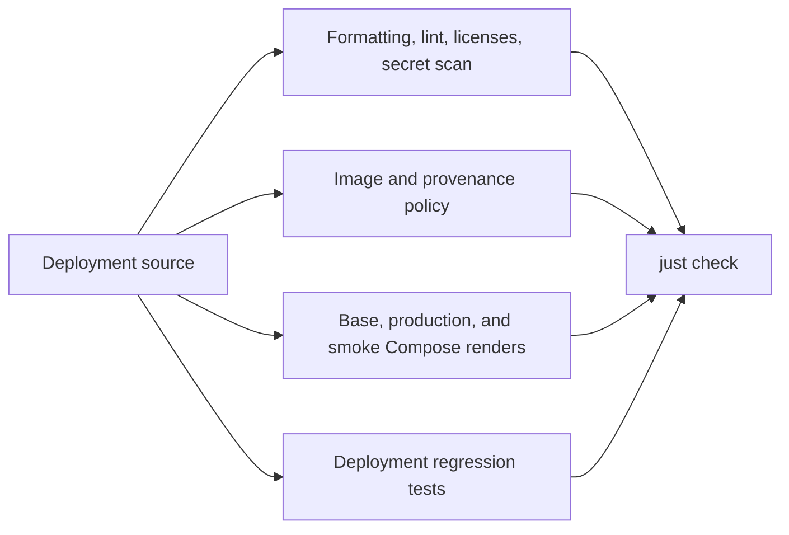

# Deployment validation guide

This repository validates the GrooveMap stack definition. It does not contain
service source code or service unit tests; those belong to the repositories
that build and publish each image.

## Required local gate

Run the same credential-free gate used by CI:

```bash
mise install
just setup
just check
```

`just check` performs all of the following without starting containers:

- verifies Ruff formatting and lint rules;
- enforces digest-pinned image inputs and repository ownership boundaries;
- checks the promoted extraction-rules and contract-fixture provenance records;
- checks dependency license policy;
- renders the base, production, infrastructure-smoke, media-smoke,
  released-fixture-smoke, and erasure-smoke Compose configurations, and the
  homelab smoke's own PostgreSQL, using validation-only image digests;
- scans the Git history and worktree for leaked secrets;
- type-checks the Python validation scripts;
- runs deployment regression tests with coverage.

The full gate is the default before review. Focused commands are useful while
iterating:

| Command | Purpose | Starts containers |
| --- | --- | --- |
| `just default` | List the public recipe surface | No |
| `just setup` | Synchronize the locked development toolchain; may use the package network | No |
| `just source-check` | Static, policy, Compose-render, and secret checks | No |
| `just typecheck` | Type-check Python validation scripts | No |
| `just test` | Run deployment regression tests and collect script coverage | No |
| `just coverage` | Alias of `just test` | No |
| `just license-check` | Validate repository and dependency license policy | No |
| `just secret-scan` | Scan Git history and the worktree with redacted output | No |
| `just audit` | Query dependency vulnerability data; network-aware and scheduled separately | No |
| `just build` | Render all supported Compose combinations | No |
| `just install-check` | Alias of `just build`; deployment has no installable artifact | No |
| `just config` | Render the base configuration using the operator's `.env` | No |
| `just config-prod` | Render the production overlay using the operator's `.env` and secret paths | No |
| `just secrets-bootstrap` | Create missing untracked host secret files; changes local state | No |

`just config` and `just config-prod` can include sensitive effective values in
their output. Review them locally and do not attach an unredacted render to a
ticket or commit it.

### Branch protection recommendation

Dependabot PR #40 moved both RabbitMQ images to the 4.4.0 digest and merged
while the Required validation job was failing, because `main` has no required
status checks. The recommendation is to require the "Required result" check in
`main`'s branch protection so a red PR cannot merge. This is a recommendation
only; nothing has been applied to GitHub.

The RabbitMQ image digest lives only in `docker-compose.yml`, on the `rabbitmq`
service and on `rabbitmq-dlq-policy-init`, which reuses it.
`scripts/check-rabbitmq-dlq-policy.py` keeps no copy of its own: it derives the
expected image from the `rabbitmq` service and requires
`rabbitmq-dlq-policy-init` to match it, so a Dependabot digest bump that updates
only one of the two fails the gate instead of desyncing them.

## Validation flow



## Test ownership

| Concern | Owner |
| --- | --- |
| Compose topology, overlays, secrets wiring, and migration-script safeguards | `deployment/tests/deploy/` |
| The media assertion's fixtures, event translation, and isolation | `deployment/tests/deploy/test_media_smoke.py` |
| The erasure assertion's export parsing, absence probes, and isolation | `deployment/tests/deploy/test_erasure_smoke.py` |
| The homelab smoke's provisioning SQL, generated override, stack/secrets/blocked-dependent checks, isolation and workflow pins | `deployment/tests/deploy/test_homelab_smoke.py` |
| Image naming, digest pinning, and promoted-artifact provenance | `deployment/scripts/check-images.py` |
| Compose rendering for supported overlays | `deployment/scripts/check-compose.sh` |
| Catalog-DLQ size-cap policy: pattern matches the real DLQ names and provisioning wiring | `deployment/scripts/check-rabbitmq-dlq-policy.py` |
| Service behavior, package behavior, and service Dockerfiles | The corresponding source repository |
| Database schema behavior and initializer image | [`database-schema`](https://github.com/groovemap-music/database-schema) |
| Shared CI behavior | [`.github`](https://github.com/groovemap-music/.github) |

## Lux regressions: failure to regression test

The operator's lux installation (deployment `6af13ec`, mixed stores, shared monitoring) hit eight
failures that mocks and render checks had missed; the Linux smoke then found a ninth and tenth (rows 9 and 10). Each now has a fix, unit and render tests that
run in `just check`, and a disposable Linux Docker smoke scenario with a negative case, so a
regression fails in CI rather than on a homelab host. The smoke column is filled from the Linux
smoke's final report; entries marked `TODO(smoke)` are pending. See
[Lux upgrade](homelab.md#lux-upgrade-from-6af13ec160fe7d) for the operator's view.

| # | Failure on lux | Fix | Unit and render tests | Linux smoke scenario and negative case |
| --- | --- | --- | --- | --- |
| 1 | `store-check-postgres` could not resolve the shared database host: the override attached the app clients but not the one-shot checks | The network example attaches every store client and check; a failing check names the store, host, service and networks | `test_external_stores.py::test_the_network_example_attaches_exactly_the_clients_of_each_store`, `::test_the_override_check_accepts_the_network_example_and_every_client_joins_both_networks`, `::test_the_failure_message_names_the_store_host_service_and_networks`, `::test_a_check_container_missing_the_stores_network_fails_closed_and_says_how_to_fix_it`, `::test_only_a_resolve_or_connect_failure_gets_the_network_hint` | TODO(smoke): scenario; negative case |
| 2 | Compose refused `configs.content` for the read-only collector; the healthcheck must validate the config the command loads | The collector reads its config through the env provider; command and healthcheck use the same source | `test_compose_one_shots_and_collector.py::test_collector_healthcheck_validates_exactly_the_config_the_command_loads`, `test_shared_monitoring.py::test_the_pinned_collector_validates_the_local_and_shared_configs`, `::test_the_pinned_collector_healthcheck_fails_an_invalid_shared_endpoint` | TODO(smoke): scenario; negative case |
| 3 | The derived Valkey exporter password was written as UID 1000 mode 0600; the exporter runs as UID 59000 and crash-looped | Every secret-reading service runs as the owner of the 0600 secrets (`${UID}:${GID}`), including Grafana and the exporters | `test_secret_identities.py::test_every_secret_reading_service_is_inventoried_and_can_read_the_secrets`, `::test_no_secret_is_remapped_or_made_readable_to_others` | TODO(smoke): scenario; negative case |
| 4 | `up --wait` failed because `rabbitmq-dlq-policy-init` exited 0 with no `service_completed_successfully` dependent | The catalog queue services depend on the initializer completing successfully | `test_compose_one_shots_and_collector.py::test_catalog_queue_services_wait_for_the_dlq_policy_to_complete`, `::test_every_one_shot_has_a_completed_successfully_dependent` | TODO(smoke): scenario; negative case |
| 5 | The console hardcoded `postgres-exporter:9187`; shared monitoring was undocumented and untested; Viewer-token guidance used an unused local admin password | Shared monitoring is an overlay (`GROOVEMAP_MONITORING=shared`) with configurable console targets and `EXTERNAL_POSTGRES_EXPORTER_ADDRESS` | `test_shared_monitoring.py::test_shared_monitoring_points_the_console_at_the_shared_services`, `::test_an_external_postgres_exporter_is_shared_or_disabled_never_unreachable`, `::test_no_active_service_depends_on_an_omitted_one`, `::test_the_endpoints_point_at_the_shared_grafana_and_never_at_a_local_admin_password`, `::test_shared_monitoring_guidance_never_suggests_a_local_grafana_admin_password` | TODO(smoke): scenario; negative case |
| 6 | No `uv` on the host: `just discogs-import-status --prod -f docker-compose.override.yml` failed; exit codes 0/3/2 must survive | Operator recipes run through `scripts/operator-python.sh`: uv when present, else `python3` 3.10 or newer | `test_operator_recipes_without_uv.py::test_import_status_exit_codes_pass_through_without_uv`, `::test_every_operator_recipe_uses_the_runner`, `::test_runner_rejects_an_interpreter_older_than_3_10`, `test_python310_compat.py` | TODO(smoke): scenario; negative case |
| 7 | Production rendering required `SOURCE_DUMP_ID` and `SOURCE_DUMP_DATE` with the embeddings job inactive | The values are required only by the job's wrapper, not by rendering | `test_compose_one_shots_and_collector.py::test_the_stack_renders_without_inactive_job_inputs`, `::test_the_embeddings_wrapper_refuses_to_run_without_real_values` | TODO(smoke): scenario; negative case |
| 8 | Reusing PostgreSQL did not add the database to the backup allowlist; generated secrets had no recovery path | Preflight and docs check backup coverage; `just recovery-manifest` lists what to encrypt; bootstrap refuses to regenerate a secret that existed | `test_recovery_manifest.py::test_manifest_lists_what_to_capture_and_prints_no_secret_value`, `::test_verify_rejects_a_removed_secret`, `::test_deploy_refuses_a_bootstrap_that_would_regenerate_a_secret`, `::test_deploy_keeps_restored_secrets` | TODO(smoke): scenario; negative case |
| 9 | Explore theme release (`graph-explorer` v0.3.0) and the console's configurable targets | Reviewed digests promoted; the console reads its probe targets from the environment | `test_external_stores.py::test_released_versions_match_the_comments_beside_the_digests`, `test_status.py::test_reviewed_images_show_their_release_and_oci_labels`, `test_shared_monitoring.py::test_the_local_stack_sets_no_console_target_mode` | TODO(smoke): scenario; negative case |
| 10 | Discogs gate never completes (discogs-sql-loader v0.3.0 writes no latch), found by the Linux smoke | discogs-sql-loader v0.4.0 (`sha256:be150770...`) is promoted; the gate and `just status` read the latch it writes | `test_external_stores.py::test_released_versions_match_the_comments_beside_the_digests`, `test_deploy.py::test_latch_probe_reads_one_boolean_and_treats_every_failure_as_no_evidence`, `test_status.py::test_a_complete_gate_with_musicbrainz_not_yet_enabled_says_to_run_deploy` | TODO(smoke): scenario; negative case |

Operator-facing summaries (`just status`, preflight, the decisions recorded in `.env`) are covered
by `test_status.py` and `test_deploy.py::test_preflight_reports_the_decisions_recorded_in_env`;
`test_external_stores.py` covers the display and the validated store settings agreeing on one
source (`::test_an_empty_shell_variable_falls_through_to_env_for_the_display_and_for_read_stores`,
`::test_an_invalid_mode_is_refused_not_displayed`).

## Validation-only image references

`config/validation.env` contains syntactically valid, non-published dummy
digests. They exist only so Docker Compose can resolve every required variable
during static configuration validation. They are not deployment inputs and
must never be copied into an environment `.env` file.

Real environments must use approved `ghcr.io/groovemap-music/<repository>`
references pinned with `@sha256:<manifest-digest>`.

The reviewed release digests are not kept in either environment file. They live
in `RELEASED_IMAGE_DIGESTS` in `scripts/check-images.py`, which is what
`just smoke-released` validates a candidate `.env` against.

## What CI starts

CI starts containers only in disposable smoke stacks, never a live environment.
Today that is one workflow, `.github/workflows/smoke-homelab.yml`, which runs
`just smoke-homelab` (below). Each smoke stack uses its own Compose projects,
pulls only digest-pinned images, needs no secrets or credentials, and removes
every container, volume and network it labelled on every exit. `just check`
itself still starts nothing.

## The homelab-shape smoke

Mocks and Compose renders missed every failure found installing GrooveMap on lux
(`gm-deployment-zg3x`). `just smoke-homelab` (`scripts/smoke-homelab.sh`, helpers
in `scripts/smoke_homelab.py`) rebuilds lux's shape on real Docker and checks it
end to end, plus the negative cases that must fail closed.

**What it builds**, on a Linux amd64 Docker host:

- a "homelab" PostgreSQL 18 (`config/homelab-smoke/compose.yml`, the stack's own
  pinned image) in its own Compose project and bridge network, with a throwaway
  CA and a server certificate for `homelab-postgres`. Its admin provisions
  GrooveMap's role, database and `pg_trgm` with the SQL in
  [homelab.md](homelab.md#what-groovemap-needs-from-each-server), then adds lux's
  60-connection limits on the role and the database. The role is not a superuser;
- the homelab's shared monitoring in the same project, on its own monitoring network:
  VictoriaMetrics, VictoriaTraces, Grafana, node-exporter, cAdvisor and a PostgreSQL
  exporter that already watches the homelab server, each on the image the stack pins;
- GrooveMap from a disposable copy of the checkout. `.env` comes from
  `scripts/env-init.py` with the reviewed digests and sets
  `GROOVEMAP_POSTGRES=external` with `verify-full`. Valkey, Neo4j and RabbitMQ are
  the stack's own. The override is generated from the skill's
  `override-external-store-network.yml`, PostgreSQL half only, so exactly
  `STORE_CLIENTS["postgres"]` join the homelab network. The operator writes the
  PostgreSQL username, password and CA (0600), and `create-secrets.sh` writes the
  rest as the running user;
- `just deploy --no-wait --no-admin --force`, with uv off `PATH`. `--force` is
  there because a CI runner cannot meet the production memory and disk minimums
  for a full import, which the fixture does not need.

**The positive path**, in order:

1. With the stack's own monitoring, as every installation starts, phase 1
   reaches `up --wait` success. Every service in Compose's render is checked:
   one-shots (`store-check-postgres`, `schema-init`, `rabbitmq-dlq-policy-init`)
   completed with 0, services with a healthcheck healthy (the collector and
   Grafana, on a fresh volume, included), read-only roots and users as rendered,
   and exactly the PostgreSQL clients on the homelab network. `secrets/` is 0700
   with every file 0600 and owned by the deploying user. `valkey-exporter`,
   running as that user, reports `redis_up 1`. That project is then removed.
2. In lux's shape, `GROOVEMAP_MONITORING=shared` with the `SHARED_*` addresses
   and `EXTERNAL_POSTGRES_EXPORTER_ADDRESS`, and the override also attaches
   exactly `MONITORING_CLIENTS` to the monitoring network (from the skill's
   `override-shared-monitoring-network.yml`). Phase 1 reaches `up --wait` success
   with the same stack checks. The collector's `up` series for RabbitMQ and the
   homelab's PostgreSQL exporter reach the shared VictoriaMetrics. The console's
   own probe code (`dashboard.platform_health`, run in its container) must report
   every service healthy and the shared ones probed as shared.
3. The p9mu regression: after phase 1, `musicbrainz_data` exists, no MusicBrainz
   container exists, and the profile is off.
4. `just discogs-import-status --prod -f docker-compose.override.yml` exits 3 with
   its reason. `just status` exits 0 and shows phase 1, the gate in progress,
   MusicBrainz waiting on the gate and PostgreSQL external, with nothing flagged.
   `just recovery-manifest` exits 0. All three run with uv off `PATH`.
5. Re-running deploy while the gate reports 3 stays in phase 1 and starts no
   MusicBrainz container. Its store check, which every `docker compose up` runs
   again, must count the stack's own connections against the 60-connection
   limits as GrooveMap's.
6. The reviewed `discogs-ingestion` image runs once against the one-record dump
   it packages (`LOCAL_MANIFEST`, see
   [the released fixture](#live-and-performance-checks)). It publishes the record
   and `extraction_complete` to all four exchanges. The real loaders then record
   their latches and the SQL loader stamps its refresh. The smoke never writes a
   latch row itself.
7. The gate reaches 0, `just status` shows phase 1 finished, and re-running deploy
   enables the musicbrainz profile from the gate and reaches `up --wait` success
   with the MusicBrainz services. The stack checks pass again.

During `up --wait` the two extractors are stand-ins (a sleep with a trivial
healthcheck, in the generated override, nothing else changed). The real
extractors would download the monthly dumps from data.discogs.com and the
MusicBrainz mirror, and the smoke contacts nothing but the registries. Step 5
runs the real Discogs extractor binary.

**Negative cases**, each failing closed with a precise message:

| Case | How it is provoked | What must happen |
| --- | --- | --- |
| Store check off the database network | the override leaves `store-check-postgres` off the homelab network | deploy exits 3: "PostgreSQL host homelab-postgres did not resolve or accept a connection from store-check-postgres", with the attachment advice; no container exists |
| Wrong CA | `secrets/postgres_ca.crt` is another CA | deploy exits 3: "certificate verify failed"; no container exists |
| Plaintext | `EXTERNAL_POSTGRES_SSLMODE=disable` to a non-loopback host, no opt-out | deploy exits 3: "EXTERNAL_POSTGRES_SSLMODE=disable sends credentials and data to homelab-postgres in the clear"; no container exists, and no warning claims the opt-out is set |
| Override rewires PostgreSQL | the override sets `POSTGRES_HOST` on `api` | the override check stops deploy with exit 3: "docker-compose.override.yml changes POSTGRES_HOST on api"; no container exists |
| Secret owner mismatch | `valkey-exporter` run as UID 59000 (redis_exporter's default, lux's crash loop) | it exits non-zero with "permission denied" on its 0600 password file |
| Broker readiness | stop the RabbitMQ application while leaving its Erlang node running | `ping` passes, the actual listener healthcheck fails, then it passes after `start_app`; policy initialization waits for both AMQP and management HTTP |
| Old log-volume ownership | mount the loader image's historical named `/logs` volume as UID 1001 | the real image exits non-zero with `PermissionError` |
| Invalid collector configuration | the bind-mounted `config/otel-collector.yaml` gains an unknown top-level key, in place | the running collector turns unhealthy through the healthcheck that validates the command's own `--config` source, naming the key |
| Failing one-shot | the override gives `rabbitmq-dlq-policy-init` an invalid overflow mode | deploy fails naming it; it exited non-zero and none of the services that wait on it, directly or not, ever started |

**lux's failures and the cases that cover them** (`gm-deployment-zg3x`):

| lux failure | Covered by |
| --- | --- |
| 1. External-store network coverage | the override from the skill example, the stack check that exactly `STORE_CLIENTS` are on the homelab network, and the store-check-off-network refusal |
| 2. Collector configuration on a read-only root | `up --wait` with the collector healthy (Compose 5.6.1, read-only), the shared endpoints coming from env, and the invalid-configuration case |
| 3. Secret ownership | `secrets/` modes and owners, `valkey-exporter` and Grafana running as the deploying user (`redis_up 1`), and the UID 59000 refusal |
| 4. One-shots and `up --wait` | `up --wait` success with every one-shot completed, and the failing `rabbitmq-dlq-policy-init` case |
| 5. Shared monitoring | the lux-shape phase: the shared-monitoring overlay, `MONITORING_CLIENTS` on the monitoring network, `up` series in the shared VictoriaMetrics, and the console's own probes |
| 6. Operator tools without uv | `just deploy`, `discogs-import-status` (0/3 and its reason), `status` and `recovery-manifest`, all with uv off `PATH` |
| 7. Disabled-job interpolation | every render and `up` of the production stack with no `SOURCE_DUMP_*` set |
| 8. Backup and recovery | `just recovery-manifest` exits 0 on the external-store deployment, and deploy's secret-change guard runs on every deploy |

**Run it locally** on any Linux amd64 Docker host with `just`, `uv`, `python3`,
`openssl` and `git`: `just setup && just smoke-homelab`. Run it as the user whose
UID the stack should use. It refuses to start where `groovemap-*` containers
exist, because the stack's container names are fixed. It never touches another
Compose project. Optional settings: `SMOKE_HOMELAB_RUN` (unique suffix),
`SMOKE_HOMELAB_SUBNET` (stack network, default `172.29.0.0/16`),
`SMOKE_HOMELAB_EVIDENCE_DIR` (keeps the report and logs) and
`SMOKE_HOMELAB_GATE_TIMEOUT` (seconds, default 600). It cannot run on Docker
Desktop for macOS: bind-mount ownership and UIDs are not the host's, and the
images are amd64 only.

**In CI**, the workflow runs on `main`, on bead branches (`wt/**`) and on pull
requests that touch Compose files, `scripts/`, `config/`, `skills/`, the
`Justfile` or the workflow. It also runs on any pull request labelled
`smoke-homelab`, and on demand (`workflow_dispatch`). It runs on `ubuntu-24.04`
with Docker Compose 5.6.1 (lux's version, checksum-pinned) and as a UID-1000
user, lux's operator UID. It writes the PASS/FAIL report to the job summary and
keeps the evidence (deploy, gate and status output, check results, the override,
and container log tails on failure) as the `smoke-homelab-evidence` artifact for
14 days.

**Runtime and cost**: the job allows 60 minutes on a standard `ubuntu-24.04`
runner (4 vCPU, 16 GB). The successful full run below took **725 seconds
(12 minutes 5 seconds)**, including both monitoring shapes, the real fixture,
MusicBrainz phase 2 and all negative cases. GitHub does not bill hosted runners
for a public repository. Pushes to the same branch cancel the run in progress.

Ordinary CI uses `env-init`'s reviewed release table. Manual `workflow_dispatch`
can select an explicit SQL or graph candidate in its scratch stack. A graph
candidate also requires the expected OCI version and full source revision;
the SQL latch candidate is attested as the v0.4.0 release below. Every stage checks both
loaders' rendered and running digests, OCI version, repository and source
revision. The only permitted status warning names exactly the explicit
unpromoted candidates. These inputs do not promote releases or alter an
installed environment. `smoke_host_uid=1001` selects the actual runner UID for
the separate tmpfs regression; the default is lux's UID 1000.

**Observed acceptance evidence (2026-11-01):**
[run 41343620122](https://github.com/groovemap-music/deployment/actions/runs/41343620122)
passed at tested commit `fd649d58e9dbcf954842c1e03ffede1134be00ff`, as actual
UID/GID `1000:1000`, Compose 5.6.1 and Docker Engine 28.0.4. The rendered and
running images, with their actual OCI version/source labels, matched these
releases in the local-monitoring, shared-monitoring and phase-2 stages:

| Loader | OCI version | Image | Full source revision |
| --- | --- | --- | --- |
| SQL | v0.4.0 | `ghcr.io/groovemap-music/discogs-sql-loader@sha256:be15077013672f69384bd75fd591801bdabd80400eaa2fd4a686e2d82f6bbb0b` | `86531426576195c1355a84909785410b70b0dde6` |
| Graph | v0.4.0 | `ghcr.io/groovemap-music/discogs-graph-enricher@sha256:6f5dd84d18aa69cc40705bbabde269cefc7d7642e0818f1db2fba2588bde9c39` | `1cf8c3cbd2401cc4b434dc80f17d5d29ab17c6f5` |

Both real loaders received `artists`, `labels`, `masters` and `releases`
completion signals for fixture version `20000101` at 19:57:56 UTC. No completion
row was inserted by the smoke. Its read-only SQL latch capture was:

```json
{"loader":"discogs","version":"20000101","signals":["artists","labels","masters","releases"],"created_at":"2026-11-01T19:57:56.872389+00:00","updated_at":"2026-11-01T19:58:03.492945+00:00","refreshed_at":"2026-11-01T19:58:03.492945+00:00","generation":1}
```

The gate started at exit 3 with no SQL latch row, then reached **exit 0 at
19:58:16 UTC**: both latches 4/4, the fresh SQL refresh stamped, and all eight
queues at ready=0/unacked=0. Phase 2 then enabled MusicBrainz and inspected
`groovemap-extractor-musicbrainz`, `groovemap-brainzgraphinator` and
`groovemap-brainztableinator` as running and healthy. The report has 29 PASS
lines: local/shared/phase-2 stack checks (79/64/77), 18 secret checks, 13 console
probes, uv-free operator recipes, p9mu resume and every negative case above.
The failing policy initializer blocked all seven dependents. Artifacts retain
per-stage renders and inspection, both images' labels, loader logs, the final
JSON gate report and the read-only SQL latch.

[Diagnostic run 41338188034](https://github.com/groovemap-music/deployment/actions/runs/41338188034)
had already proved SQL v0.4.0 reached 4/4 and refreshed, while graph v0.3.0 lost
concurrent signals and correctly held the gate at 3 (2/4); graph v0.4.0 fixes
that race. Earlier run 41253011030 used SQL v0.3.0 (`09f55827f972…`) and cannot
establish a v0.4.0 defect.

## Live and performance checks

The following commands are intentionally outside `just check` and CI because
they can start containers, mutate an environment, or consume significant
resources:

| Command | Requirement |
| --- | --- |
| `just secrets-bootstrap` | Local authorization to create missing files under untracked `secrets/`; it never overwrites existing values |
| `just smoke` | Operator approval and real digest-pinned service images in `.env` |
| `just smoke-media` | Operator approval and real digest-pinned service images in `.env` |
| `just smoke-erasure` | Operator approval and real digest-pinned service images in `.env` |
| `just smoke-infra` | Operator approval to start the infrastructure smoke stack |
| `just smoke-released` | Operator approval and a reviewed `GM_RELEASED_STACK_ENV_FILE` containing approved digests for every internal image |
| `just smoke-released-fixture` | Operator approval and a reviewed `SMOKE_RELEASED_FIXTURE_ENV_FILE`; runs the published Discogs tiny fixture through RabbitMQ and both stores |
| `just performance` | Operator approval, a running target environment, and an approved performance-runner image |
| `just down` | Operator approval because it changes the current environment |

Do not use these commands as substitutes for the static gate. Record the exact
environment, image digests, and outcome when an operator approves a live test.
`just smoke-released` rejects mutable tags and validation-only digests before
starting containers, runs the schema initializer twice before applications,
waits for service health, exercises graceful consumer shutdown, and retains
service status and logs on failure.

`just smoke-released-fixture` is likewise outside pull-request CI: it pulls and
runs published containers, starts RabbitMQ, PostgreSQL, and Neo4j, and therefore
requires explicit operator approval. It creates the isolated Compose project
`groovemap-released-fixture-smoke`, exposes only RabbitMQ's management API on a
loopback port, and removes the project and its volumes on every exit. The run
accepts only the complete reviewed release set from `RELEASED_IMAGE_DIGESTS`.

The fixture itself is not duplicated in this repository. The digest-pinned
`discogs-ingestion` v0.3.1 image packages the versioned v1 manifest at
`/usr/share/discogs-ingestion/contracts/extractor-smoke/v1/manifest.json`.
The harness waits for the released Discogs graph and SQL consumers to bind,
runs that extractor manifest once, reads the image's pinned expected data event,
and polls PostgreSQL and Neo4j for its release, canonical media values, and
media relationships. This deployment slice complements rather than replaces
each service repository's real-engine integration tests.

### The canonical media and identifier assertion

`just smoke-media` is the end-to-end proof that ADR 0007's canonical `media` block
survives the whole path from a producer event to both stores, and that
[ADR 0011](https://github.com/groovemap-music/design/blob/main/docs/adr/0011-catalog-identifiers-and-manufacturing-credits.md)'s
identifier path survives it as far as a barcode a person can look up. It is a versioned
script rather than a runbook step, so both claims can be re-made on demand.

The required identifier-capable images are recorded in
[Maintenance](maintenance.md#recorded-release-digests). Run the disposable smoke
against those reviewed digests to verify the lookup path; this does not promote
them to a live environment.

If a disposable worktree is outside the Docker host's shared paths, set
`SMOKE_MEDIA_PROJECT_DIRECTORY` to a host-shared checkout only after verifying
that every bind-mounted config file needed by this smoke is byte-identical to
the worktree's file. This opt-in changes Compose bind resolution, not the
Compose files, images, fixture, project name, or assertion.

**What the operator provides**: an untracked `.env` in which every `*_IMAGE` variable is an
approved `ghcr.io/groovemap-music/<repository>@sha256:<manifest-digest>` reference.
[Maintenance](maintenance.md) records the promoted digests. The script refuses to start if a
variable still holds an `.env.example` placeholder, a `config/validation.env` digest, or
anything not pinned by digest — a media assertion against images no environment runs would
prove nothing. `.env` is untracked and must never be committed.

**What it starts**: the schema initializer, RabbitMQ, PostgreSQL, Neo4j, Valkey, both SQL
loaders, both graph enrichers, the catalog API, and the telemetry backends those services
declare as dependencies, under the Compose project
`groovemap-media-smoke` with `docker-compose.media-smoke.yml`. The extractors never run. A
smoke stack has no dumps to download, so the run publishes the release events itself. The
API is there for one request: a minted alias is only worth having if something resolves
through it, and the erasure smoke — the other stack that runs the API — has no broker and
no loaders, so it could only look up a row it had inserted itself.

**What it publishes**: the two producers' contract fixtures, promoted verbatim into
`config/media-smoke/` with their upstream repository, commit, and digest recorded in
`config/provenance.json`. The run rewrites only the identity fields the stores constrain —
the Discogs release id, the MusicBrainz release UUID, and the Discogs id the MusicBrainz
release matches on — and adds the Discogs release's country, which is a raw passthrough
field rather than a canonical block and so is absent from the producer's representative
fixture. It never edits the `media`, `identifiers`, or `companies` blocks. Each event is
published onto its producer's
durable fanout exchange through the RabbitMQ management API, after every contract queue has
bound a consumer, because a fanout exchange drops a message that reaches no queue.

**What it proves**:

- `releases.media` is populated for the Discogs fixture and its `families` match the block
  the producer published;
- `musicbrainz.releases.media` is populated for the MusicBrainz fixture and its `families`
  match that producer's block;
- Neo4j carries `Medium` and `MediaFamily` nodes joined by `IN_FAMILY`;
- the release is joined to its medium by `ISSUED_ON {source: 'discogs'}`, and by
  `ISSUED_ON {source: 'musicbrainz'}` once the MusicBrainz enricher matches it — which is
  what shows both catalogs' media reconciling onto one release node;
- exactly one currently valid `provider_aliases` row carries the normalized barcode, and
  its `native_id` is the `releases.gm_item_id` the published release resolved to;
- the release is credited to the pressing plant by
  `CREDITED_TO {role_category: 'pressing', source: 'discogs'}` and the `Company` node
  carries the name the event published;
- `Release.country` is the country the event published;
- `GET /api/lookup/barcode/<value as printed>` answers 200, normalises the value to the
  same `external_id` the alias is keyed on, and names the release.

The lookup probe deliberately sends the barcode **as printed**, grouping spaces and all.
The endpoint normalises with the namespace's own rule, and sending an already normalized
value would leave that rule untested.

Every assertion is polled to a deadline, because both loaders and both enrichers batch
their writes behind a flush interval. The run prints one `PASS`/`FAIL` line per assertion
and exits non-zero if any of them failed.

**What it leaves behind**: nothing. The run tears its own stack down with
`docker compose --project-name groovemap-media-smoke down --volumes --remove-orphans` from
an exit trap, including on failure. Its own project name is what keeps it away from an
operator's volumes; its own subnet, its own container names, and two loopback-bound ports —
the broker's management API and the catalog API — keep it away from a running environment.

**Knobs**, all optional and all environment variables: `SMOKE_MEDIA_PROJECT`,
`SMOKE_MEDIA_ENV_FILE`, `SMOKE_MEDIA_RABBITMQ_PORT`, `SMOKE_MEDIA_API_PORT`,
`SMOKE_MEDIA_TIMEOUT`,
`SMOKE_MEDIA_SUBNET`, and `SMOKE_MEDIA_SERVICE_PLATFORM`. The last one matters when the
workstation's architecture is not the one the internal images are published for; it applies
only to those services, so the broker and both stores stay native.

### The erasure and export assertion

`just smoke-erasure` is the end-to-end proof that [ADR 0010](https://github.com/groovemap-music/design/blob/main/docs/adr/0010-first-party-events-consent-and-deletion.md)'s
export and deletion claims hold: a real account's activity can be exported as well-formed
NDJSON, and after an erasure nothing keyed to that account survives in PostgreSQL, Neo4j, or
Valkey. Like `just smoke-media`, it is a versioned script rather than a runbook step, so the
claim can be re-made on demand.

**What the operator provides**: an untracked `.env` in which every `*_IMAGE` variable is an
approved `ghcr.io/groovemap-music/<repository>@sha256:<manifest-digest>` reference, the same
requirement [`just smoke-media`](#the-canonical-media-and-identifier-assertion) has.
[Maintenance](maintenance.md) records the promoted digests. `scripts/smoke-erasure.sh` refuses
to start if a variable still holds an `.env.example` placeholder, a `config/validation.env`
digest, or anything not pinned by digest, and refuses an `.env` that declares no `*_IMAGE`
assignment at all — an assertion against images no environment runs would prove nothing.
`.env` is untracked and must never be committed.

**What it starts**: the schema initializer, PostgreSQL, Neo4j, Valkey, the catalog API, and
the unpublished telemetry backends the API declares as dependencies, under the Compose project `groovemap-erasure-smoke` with `docker-compose.erasure-smoke.yml`.
Naming the API pulls in its declared dependencies, so no extractor and no broker consumer
run: this assertion drives the API itself rather than a catalog ingest. PostgreSQL, Neo4j, and
Valkey stay unpublished; the assertions reach them through `docker compose exec`. Only the
API's own health-gated port is published, on loopback.

**What it seeds**: the run registers a throwaway account against the disposable stack's own
API (email domain `smoke.invalid`, reserved by RFC 2606 so it can never be delivered to),
grants both published consent purposes (`product_analytics` and `model_training`), then
performs a search and a recommendation request so `activity.events` (and the
`activity.event_idempotency` key each event holds) and `activity.impressions` rows exist for the account. It asserts each store holds the account's
data *before* erasing — PostgreSQL for the activity, subject-link, and collection rows,
Neo4j for the account's `User` node and `COLLECTED` edge, and Valkey for its recommendation and
snapshot keys — so an absence probe cannot later pass only because the seed silently never
happened.

**What it proves**:

- the export endpoint returns `application/x-ndjson`, one JSON object per line shaped
  `{"kind": …, "record": {…}}`, whose `kind` values are drawn from the documented export
  vocabulary and appear in the documented order, with at least one `event` line and one
  `impression` line;
- after erasure, `activity.events`, `activity.event_idempotency`, `activity.impressions`, and
  `activity.user_subjects` hold zero rows for the subject (the idempotency keys are released by
  `database-schema`'s delete triggers, not by the caller), and `activity.erasures` holds a row for it;
- `user_collections`, `owned_copies`, and `observations` hold zero rows for the account;
- the `users` row is soft-erased: its email carries the `erased+` prefix and `is_active` is
  `false`;
- no `User` node for the account remains in Neo4j;
- no `recommend:*` or `snapshot:usercount` Valkey key for the account remains.

Every absence probe is scoped to the id this run created, never a bare count another run's
leftover row could satisfy in reverse.

**What it leaves behind**: nothing. `scripts/smoke-erasure.sh` tears the stack down with
`docker compose --project-name groovemap-erasure-smoke down --volumes --remove-orphans` from
an exit trap, including on failure, after printing container status and the API's logs for a
failed run. Its own project name, its own subnet, and a loopback-only API port keep it away
from a running environment, the same isolation `just smoke-media` uses.

**Knobs**, all optional and all environment variables: `SMOKE_ERASURE_PROJECT`,
`SMOKE_ERASURE_ENV_FILE`, `SMOKE_ERASURE_API_PORT`, `SMOKE_ERASURE_TIMEOUT`,
`SMOKE_ERASURE_SUBNET`, and `SMOKE_ERASURE_SERVICE_PLATFORM`. The last one matters when the
workstation's architecture is not the one the internal images are published for; it applies
only to the schema initializer and the API, so PostgreSQL, Neo4j, and Valkey stay native.

`just check` and CI never run `just smoke-erasure`: it starts containers and registers,
exports and erases a throwaway account in its own disposable stack, so it requires the
same operator approval as `just smoke-media` and the other live checks below.

## Coverage

`just test` writes `coverage.xml` locally and prints missing lines. CI uploads
that report under the `deployment` Codecov flag. Coverage here measures the
deployment validation scripts only; service coverage remains with each source
repository.
